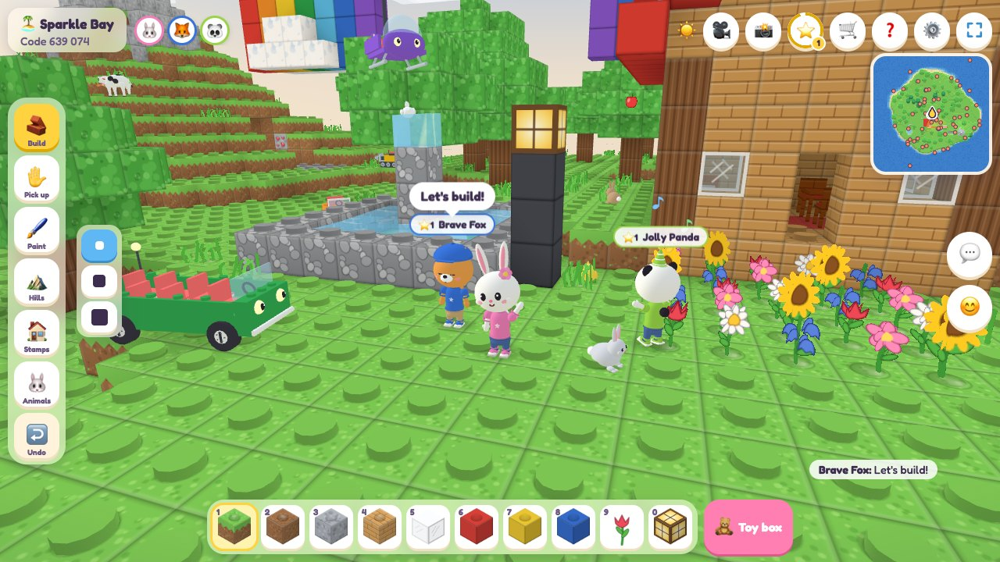

# Kids World

A cozy 3D block-building island game for kids, to play together in the browser. Build with toy bricks, raise hills, put up huge tents, plant fruit trees, grow carrots, strawberries and pumpkins on a farm of your own, dig for jewels in the mines, invite bunnies and ducks to move in, bring a pet of your own everywhere you go, ride ponies, elephants, unicorns and dolphins, drive a car, a boat, a digger and a mine cart, scoot about on a kick scooter, take your friends along in a bus or a ferry, fly a helicopter and a hot-air balloon, sit down to a tea party together, play mini-games together at a video arcade, collect capsule toys from gashapon machines, play the piano, watch TV, draw pictures together on a drawing board, visit your friends' islands, free adventure islands from grumpy monsters (giant mosquitos among them, darting down out of the air) together, and build towers to keep them off the Star Stone. Everything is made of little studded bricks.

**Play now:** <https://ctbot000.github.io/kids-world/>



1. **🔑 Log in**, or **✨ Make my login** if you have none yet: nobody plays without one, so the title screen has only those until you do (logging in needs the [island keeper](#the-island-keeper) online; once you are logged in on a device, playing there never does).
2. Press **Make an island**, pick a kind of island (Sunny, Snowy, Candy, Volcano, Fun Park or Flat Land) and how big it is (Cozy, Big or Huge), and name it: type any name, or roll one with 🎲. Turn on **⚔️ Adventure** for monster camps to free with friends, **🗼 Tower defense** for waves of monsters to see off with towers, or **👾 Monsters** if you want some about.
3. Tell a friend your six-digit **island code** (it's at the top of the screen). They press **Visit a friend** and type it in, or pick your island from **🌍 Islands open now** under it. Up to 8 players can be on one island together.
4. Build together. Your island is saved on your device, and **My islands** opens it again later. While the [island keeper](#the-island-keeper) is online, it keeps a copy too, and logging in on another device brings you and your islands there.

## What you can do

- **Build** with 16 colours of toy bricks, plus grass, sand, snow, wood, glass, lamps, star blocks, tent cloth, cookies, candy canes, flowers and more. There are over 90 blocks and plants in the toy box.
- **Tools:** Build, Pick up, Paint and Hills (raise, dig or flatten the land), each in three sizes, and Undo.
- **Interior design:** the toy box's 🛋️ **Home** tab has carpets in four colours, a wood floor, checked tiles and four wallpapers, and furniture: a chair, a rocking chair that rocks gently back and forth with you in it, a desk chair on five little wheels, a sofa, a bed, a bookshelf, a kitchen counter, a stove, a fridge, three TVs, a broadcast station, a computer glowing with code, a school desk, a chalkboard, a drawing board, a study desk with drawers, a shelf of books, a desk lamp that lights up and a chair (sit at it to study: see **Studying**), a fireplace that glows, a picture for the wall, a table, a tea table laid with a teapot, cups and cookies, a pet bed, a round basket with a soft pink cushion for your pet to curl up in (see **A pet of your own**), a hot tub, a round wooden barrel of steaming water that glows to light the room at night, a floor lamp, a potted plant, an electric fan whose head sweeps slowly from side to side and a ceiling fan with a light under it to put up against the ceiling, their blades going round, a fish tank on a cabinet with a castle, waving water plants, bubbles and five bright fish swimming round under its lamp, a round fish bowl of goldfish on a stand, a cuckoo clock for the wall, its pendulum swinging and a little bird popping out of its door on the hour, and a tower clock, a block with a lit face on every side to put on top of a clock tower; clocks' hands tell the island's time of day. Furniture turns to face you as you put it down (a picture faces out from the wall you put it on), and sofas, kitchen counters and tables side by side, or beds one behind the other, join up into one long one. Light and the view go round it, and you can stand on it; lamps and the fireplace light up the room at night. Walk up to a chair or a sofa someone is not already in and tap 🪑 **Sit** beside it (or press <kbd>Q</kbd>) to sit on it, facing the way it faces, or to a bed and tap 🛏️ **Lie down** to snuggle up in it, eyes closed (curled up on your side in a bed one block long, stretched out in two or more joined); walk, jump, <kbd>Shift</kbd> or <kbd>Q</kbd> gets you up again, in front of it, and friends see you sit and lie down. In a desk chair, walking rolls it gently along the floor instead of getting you up — a slow little ride that coasts to a stop, turns the way you steer and leaves the chair where you got off (only where you may build, for it is carried along as it goes) — and <kbd>Shift</kbd> or <kbd>Q</kbd> gets you off beside it. Sit down at a tea table while a friend sits at one too, and it's a tea party, with hearts over the table. Slip into a hot tub and the warm water comes up to your shoulders, with wisps of steam rising off it; two fit in one side by side, and soaking with a friend shows hearts over the tub. Put down ten pieces for the 🛋️ Home Sweet Home sticker, sit down once for 🪑 Comfy Spot, and sit down to tea with a friend for 🫖 Tea Party.
- **Studying:** sit down at a Study Desk and your workbooks open: ➕ adding, ➖ taking away, ✖️ times tables, ➗ sharing and 🔤 spelling (hear the word, see its picture and a sentence, and spell it). It is real practice that remembers what you know: new facts are shown to you first, then you type the answers; a miss shows the right answer and a way to work it out (make ten first, or the times fact before it), and comes back a few questions later. Each fact you get right first time goes up a box, a miss goes back to the first, and four boxes up it is known by heart; every study asks the ones you know least, a few new ones and one you know by heart, so it does not slip away. Your notebook stays on the device you study on; what you learn earns XP and the 📚 Bookworm, 💡 Know It by Heart (25) and 📝 Star Student (100) stickers.
- **Stamps** put down a whole build in one tap: a cozy house (furnished inside), a castle tower, a bouncy castle, a huge circus tent and camping tent, a rainbow, a fountain, a sail boat, a snowman (with a carrot nose, coal eyes, stick arms and a top hat), a flower garden, a vegetable patch, a picnic, a tea party, a school, an office (a wood-floored room with desks and computers, wheeled chairs to scoot between them, bookshelves, a wall TV, lamps and a plant) and more.
- **Animal friends:** bunnies hop, chicks peck, sheep graze and ducks paddle, leaving little ripples that spread out behind them on the water. Up in the air, birds flit between the treetops, the roofs and the grass, owls sleep in a tree all day and come out at night, bees go from flower to flower, seagulls circle high over the beach and butterflies flutter. After sundown, fireflies come out over the flowers and the open grass, softly blinking as they drift on the breeze (just to look at), and fade away again at dawn. Pet them for hearts. Give one a fruit or a vegetable and it follows you around, and a flying friend sits on your head when you stand still. With the Animals tool you can invite new friends to move in. (The giant mosquitos that used to drone about the meadows are monsters now: see **Monsters**.)
- **A pet of your own:** pick one in **🐾 My pet** (on the title screen, or in ⚙️ Settings on an island): a puppy, a kitten, a bunny, a hamster, a piglet, a duckling, a parrot or a baby dragon, in the colour you like, with any name you type (or roll one with 🎲). It wears a collar the colour of your T-shirt and comes along to every island you go to, yours or a friend's, and friends see it too. It trots along behind you the way you went, runs to catch up, hops up steps and swims after you; when you stop it comes to sit beside you, looking up at you, lies down after a while and falls asleep at night — and if you have put down a 🛏️ Pet Bed (in the 🛋️ Home tab) nearby, it walks over to the nearest one, curls up on its cushion and sleeps there instead, getting up when you walk off or morning comes. A parrot sits on your head when you stand still (beside you if a bird is already there), and a baby dragon flies round you and lands beside you. Say something in 💬 Talk and a parrot squawks it back a moment later in a little speech bubble of its own — a parrot that is asleep, or left far behind, stays quiet. On a ride it rides along with you, behind you on the animal or in the vehicle, and hops down when you get off. Left far behind, or stuck somewhere it cannot follow, it pops over to you. It does what you do: wave and it begs, dance and it spins round, cheer or clap and it jumps, giggle and it rolls over. Tap anyone's pet to pet it, or give it a fruit or a vegetable from your basket, and its owner hears who did. While you choose in My pet, it sits in front of you for you to see.
- **Sea creatures:** schools of fish dart about the shallows (one jumps out now and then), dolphins leap out of the sea, a whale swims out in the deep and blows water out of its blowhole, crabs walk sideways along the beach, turtles bask on the sand and paddle in the sea, and an octopus sits on the sea floor and changes colour when you pet it. Giant clams rest on the sandy floor of the shallows: tap one and its shell gapes open — sometimes a pearl pops into your basket, sometimes nothing but bubbles — and it shuts itself again after a few minutes, ready for another try. Swim out to meet them; fed a fruit, a sea creature follows you as far as the water goes. Snowy islands have a little colony of penguins, which waddle, slide on their tummies and dive and leap in the sea, and seals, which lie about on the shore, clap their flippers, play with a ball and swim.
- **Big animals to ride:** ponies gallop about and cows graze, an elephant flaps its ears and a giraffe looks over the treetops, and a big friendly dog bounds after them, tongue out and tail wagging (it woofs when you pet it); snowy islands have reindeer (one now and then with a shiny red nose) and polar bears that love a swim, and candy islands have unicorns. Walk up to one and tap **Ride** beside it (or press <kbd>Q</kbd>): you steer it as you walk, faster than you can run, and it jumps higher than you can (the elephant sprays water from its trunk instead), swims, and climbs out onto the bank. Swim out to a dolphin or the whale to ride them too: a dolphin leaps out of the sea with you on its back, and the whale blows water over you. The saddle is the colour of your T-shirt, and friends see you ride. <kbd>Q</kbd> or 👋 **Get off** (or <kbd>Shift</kbd> or ⬇️, on land) gets you down beside it, where it stays a while; fed a fruit, a big animal follows you too.
- **Vehicles to drive:** every island has a toy car, a speedboat by the shore, a yellow digger and a kick scooter, and every mine has rails down the middle with a mine cart at its doorway. Walk up to one and tap **Drive** beside it (or press <kbd>Q</kbd>), and steer it as you walk. The car is the fastest thing on land and hops up a step; the boat goes anywhere there is water, and never out of it; jump honks the horn (the mine cart rings its bell), and everyone hears it. On the kick scooter you stand on the deck, one foot planted and the other kicking along: it is nimbler than the car and quicker than you run, hops the little steps by itself and leans into its turns, and jump rings its bell (its grip pad turns the colour of your T-shirt). A 🛷 **sled** in the toy box's 🚗 Vehicles tab is for the snow: put one down, hop on and push along — on snow it glides faster than you run and slides down slopes all by itself, coasting a way on the flat before it stops; on grass it is slow going and soon stops. You sit with your legs out in front, and pull back to brake. A 🚐 **paint van** in the 🚗 **Vehicles** tab paints the ground as you drive: pick a colour with the 🖌️ **Paint** tool (a cube block in your hotbar slot), bring a van, drive round and it rolls a road or a field of that colour behind it, a few blocks wide — and undo takes the whole trail away at once. It paints only the natural ground, never anything anyone built, planted or furnished, the same rule the digger's drill follows the other way round. A 🚜 **lawn mower** in the 🚗 **Vehicles** tab mows as you drive: the grass it rolls over turns to a short mown stripe a few blocks wide, and the plants in its path pop off, the flowers into your basket as 💐 **Flowers** (put one down as a bunch, or sell them in the 🛒 shop). It leaves alone anything anyone built, rails, sprouts, farmland and its crops. It mows only the grass that grows there by itself — never anything anyone built or planted, nor the farmland, nor the crops growing in it — and jump honks like the car. The digger digs through the ground it drives into, three blocks wide and three high: hold jump to dig up a step at a time, or <kbd>Shift</kbd> or ⬇️ to dig down, and any jewels it digs out go in your basket. It never digs through anything anyone built. A mine cart rolls along its rails, round corners and up and down slopes, and on by itself when you let go, faster downhill; pull back to stop it or go the other way, and at a fork it goes the way you push. Put down more **Rails** from the toy box (they join up by themselves, and a rail a step higher makes a slope), and bring more vehicles from its 🚗 **Vehicles** tab. <kbd>Q</kbd> or 👋 **Get out** gets you out beside it, where it stays; tap a vehicle and it honks.
- **Riding together:** every island also has an open-top bus near where everyone comes in and a ferry out on the sea, each with six seats for friends behind the driver's. The first one on drives; everyone else walks up and taps **Hop on** (or presses <kbd>Q</kbd>) to sit in the next free seat, and rides along wherever the driver goes, seen in their seat by everyone. Riding along, jump honks too, and <kbd>Q</kbd> or 👋 **Get out** gets you out beside it. When the driver gets out, the others stay in their seats until somebody else takes the wheel. Each seat turns the colour of the T-shirt of whoever sits in it.
- **Flying:** every island also has a helicopter and a hot-air balloon near where everyone comes in. Get in and hold jump to take off and fly up, steer as you walk, and hold <kbd>Shift</kbd> or ⬇️ to come down; let go of both and it hovers, and it lands when it comes down onto the ground (or floats, onto water). The helicopter is quick, its rotor whirring, with a seat for two friends behind the pilot; the balloon drifts slowly, its burner roaring as it climbs, with room for four friends in its basket. Friends hop on the way they do in the bus. Get out up in the air and you fly, and the helicopter or the balloon you left comes gently down by itself.
- **Elevators:** put down **Elevator** pads from the toy box (Building) in a column, one above the other, or use the 🛗 **Elevator Tower** stamp. Stand on a pad and jump to ride up to the next pad above, or press <kbd>Shift</kbd> (⬇️) to ride down to the one below; you glide through anything in between, and friends see you go.
- **Trampolines:** put down **Trampoline** blocks from the toy box (Building), or use the 🤸 **Bouncy Castle** stamp, a floor of them inside soft walls. Jump on one and you bounce back up, lower each time until you stop; hold jump and you bounce higher and higher instead, up to eight blocks high. <kbd>Shift</kbd> (⬇️) stops you on the next bounce. Friends see you bounce.
- **Doors:** put an **Oak**, **Walnut** or **Blue Door** from the toy box (Building) in a gap in a wall. Walk up to it and swing at it (<kbd>X</kbd>, or the 👊 button, which shows up in front of a door) and it swings open for you to walk through; the next swing shuts it. Anyone may open and shut a door, even where only the island's owner builds, so nobody is ever stuck in or out, and friends see it swing. Undo takes a door you put down away, open or shut. Two doors of the same wood placed one above the other join into one tall door, the way beds join end to end: one swing of it opens or shuts the whole thing, and picking it up (or Undo) takes it away whole. Doors of different woods, or doors only side by side, stay separate.
- **Video arcade:** put down an arcade machine from the toy box's 🛋️ Home tab (👾 **Bop-a-Blob**, 🃏 **Picture Pairs**), or a whole arcade of six in a lit hall with the 🕹️ **Video Arcade** stamp. Walk up to a machine and tap **Play** beside it (or press <kbd>Q</kbd>): its game opens, its screen glows in the dark, and everyone at that machine plays it together. On Bop-a-Blob, grumpy blobs pop out of nine holes faster and faster for thirty seconds — tap one to bop it (a golden one is worth three), all of you racking up one score together with your own bops counted beside it. On Picture Pairs, sixteen cards are face down and you take turns flipping two: a pair stays up for whoever found it, and the board is done when all eight are found. Join in any time (a friend arriving mid-round just picks up a controller), a good round pays out a few 🪙 coins, and the games are never saved: an island opened again starts with none.
- **🙈 Hide and seek:** with friends on the island, tap 😊 (or the island's name at the top) and **🙈 I'll be it!** You are it: your eyes shut and the island goes dark while you count to 20 and everyone else runs off to hide (you can't move), then you have three minutes to find them. Come within a couple of steps of a hider with nothing solid in between (window glass hides nobody) and they are found, with a 💥 over them for everyone to see. While you look, hiders' name tags, their pets and their dots on the maps are hidden from you, so they hide for real. The round is over when everyone is found or the time is up; a hider never found earns 🪙 3 coins, and the seeker a coin for each friend found. A bar over the hotbar shows the count, the time left and how many are found; the seeker or the island's owner can 🏳️ stop a round, and it ends if the seeker leaves. Newcomers watch the round going and play the next.
- **Gashapon:** put down a gashapon machine (a real-looking capsule toy machine, not made of blocks: a clear glass globe packed with two-tone capsules on a glossy red cabinet, with a chrome handle and a chute behind a smoked flap) from the toy box's 🛋️ Home tab — three stand at the back of the 🕹️ Video Arcade stamp too. Walk up to one and tap **Turn** beside it (or press <kbd>Q</kbd>): put in 🪙 5 coins and turn the handle, and in the machine's window, in 3D, the handle clicks round, a capsule pushes out of the chute, bounces and wobbles, and pops open (tap it to open it sooner): the lid flips off and a little vinyl figure springs out in a burst of light — one of **18 capsule toys**: eight ★ common ones (a Tiny Dino, a Beep Robot, a Friendly Ghost and more), seven ★★ rare ones (a Sparkle Unicorn, a Splashy Whale, a Flying Saucer, a Waddle Penguin, a Lucky Cat, a Sea Turtle, a Little Fox) and three ★★★ super rare ones (the Golden Dragon, the Rainbow Phoenix and the Starlight Jellyfish). The machine's window shows your collection, each toy you have as its 3D figure with how rare it is and how many you have, and each one still to find as a closed capsule with how rare it is. Your toys are in your 🎒 backpack too, the rarest first. The toys are yours, kept with your coins and gear on every device.
- **🎹 Pianos:** put down a **Piano** (an upright of dark polished wood, the music on its stand and three gold pedals) or a **Grand Piano** (shiny black, curving in to its tail, its lid propped open) from the toy box's 🛋️ Home tab. Walk up to one and tap **🎹 Play** beside it (or press <kbd>Q</kbd>): you sit down on a piano bench in front of its keys, hands on the keyboard, and its keyboard opens, two octaves from middle C, to tap — two fingers at once too — or to play on your own keyboard, the low octave along <kbd>Z</kbd> to <kbd>M</kbd> with its black keys on <kbd>S</kbd> <kbd>D</kbd> <kbd>G</kbd> <kbd>H</kbd> <kbd>J</kbd>, and the high one along <kbd>Q</kbd> to <kbd>I</kbd> with its black keys on <kbd>2</kbd> <kbd>3</kbd> <kbd>5</kbd> <kbd>6</kbd> <kbd>7</kbd>. With every note you play, the hand on that side of the keyboard glides over to the key, palm down and fingers arched over the keys, and the finger that plays pushes it down, the others rippling and your head swaying with the music, and friends see you play it just so. Little notes float up from the piano, and friends nearby hear you play, softer the further away they are (a grand rings a little longer). Pick a song — ⭐ Twinkle, Twinkle, Little Star, 🐑 Mary Had a Little Lamb, 🎉 Ode to Joy or 🎂 Happy Birthday — and the next key to play glows until you have played it all through, for the 🎹 Piano Star sticker.
- **📺 TVs:** put down a **TV** on its stand, a **Retro TV** (a wooden box on little legs with two knobs and rabbit-ear antennae) or a **Wall TV** that hangs on the wall you tap, from the toy box's 🛋️ Home tab. Their screens glow and light up the room at night. Walk up to one and tap **📺 Watch** beside it (or press <kbd>Q</kbd>): its picture opens, a little cartoon on each of five channels — 🐠 Fish Tank, 🐰 Bunny Hop, 🚀 Space Trip, 🌦️ Island Weather (this island's own weather and time of day, with a news ticker) and 🪩 Dance Party. Flip through them with ◀ ▶, a tap on a channel, the arrow keys or <kbd>1</kbd> to <kbd>5</kbd>, with a moment of static in between; the next TV you watch opens on the channel you last watched. Everyone watches what they like on their own screen. Flip through five channels for the 📺 Channel Surfer sticker. And while the grown-ups have a show on air from the keeper's admin page ([TV broadcasts](#the-island-keeper)), every TV has a sixth channel, **📡 Live**, the same on every TV, and everyone playing is told what is on: a YouTube video, all at the same place in it, or a video from the keeper's computer, live, with its sound. The island music goes quiet while it plays.
- **📹 Broadcast stations:** put down a **Broadcast Station** (a TV camera on a tripod, its lens glowing blue and its red ON AIR light on top) from the toy box's 🛋️ Home tab, after the TVs. Walk up to it and tap **📹 Go live** beside it (or press <kbd>Q</kbd>): your camera opens in a window, like a mirror, once you say yes to the camera and the microphone. Tap **🔴 Go live** and you are on every TV in the game, on every island, picture and sound, the same way round as you see yourself at the station, on a channel of its own, **📹 On Air** (after a TV's own five, and before 📡 Live), and everyone playing is told; the window shows how many TVs are watching, and **🎙️ Mic on** turns your microphone off and on. **⏹️ Stop**, closing the window or picking the station up ends it. One at a time in the whole game: while someone is on air, anyone else who tries is told to wait. It goes through the [island keeper](#the-island-keeper), which tells every page connected to it who is on air, as the admin page's TV broadcasts are told, and takes you off air if your page's connection to it goes: going live needs the keeper online. Your page is the TV station, a PeerJS peer every TV watching calls for the picture and sound, live over WebRTC, so each TV takes its own stream from you; nothing but who is on air goes through the keeper. The island music goes quiet for you while you are live. A camera needs the page on https or on this computer.
- **🏫 Schools:** stamp a 🏫 **School**: a red-brick schoolhouse with a wide door, windows down both sides, a clock on its front gable and a bell in a little tower on the roof, and inside one big classroom — three rows of school desks facing a long chalkboard, the teacher's desk, bookshelves and lamps. Or put down a **School Desk** (a little desk with its chair joined on, to sit at) and a **Chalkboard** (it hangs on the wall you tap, and chalkboards side by side join into one long one) from the toy box's 🛋️ Home tab, after the broadcast station. Walk up to a chalkboard and tap **✏️ Class** beside it (or press <kbd>Q</kbd>), and pick a class: 🧒 Year 2 of elementary school or 🧑‍🎓 Year 3 of middle school, three questions each out of the same banks as the extra-credit quizzes, each with four answers to pick from — a coin for every answer right in Year 2, two in Year 3, and XP. After a class there is a two-minute break before the next one of that kind. A class counts toward the 🧠 Quiz Whiz and 💯 Perfect Score stickers.
- **🍳 Cooking classes:** walk up to any **Stove** (from the toy box's 🛋️ Home tab) and tap **🍳 Cook** beside it (or press <kbd>Q</kbd>), and pick a recipe: 🥞 Pancakes, 🍕 Pizza, 🥗 Salad, 🍪 Cookies, 🍲 Veggie Soup or 🥪 a Sandwich. Each is four steps, and the class asks “What comes next?” with three steps to pick from; the steps done go into the pan as you go. A step right first time is a coin; a wrong one is only “Not yet!”, so the dish always gets made — with XP, and after it a two-minute wash-up before that recipe again. Or stamp a 🍳 **Cooking School**: a white building with a big chef's hat on its roof, and inside two rows of cooking stations facing the teacher's kitchen. Cook a dish for the 🧑‍🍳 Little Chef sticker, and 25 for 🎂 Master Chef.
- **🎨 Drawing boards:** put down a **Drawing Board** (a whiteboard on a stand, a tray of markers under it) from the toy box's 🛋️ Home tab, after the chalkboard. Walk up to it and tap **🎨 Draw** beside it (or press <kbd>Q</kbd>): its picture opens in a window to draw on with a finger or the mouse — twelve colours, a thin, a medium and a thick brush, 🪣 fill to colour in a patch, 🧽 the eraser, and 🗑️ Wipe clean (tap it twice). 🖼️ **To my gallery** keeps the picture in your own **🖼️ gallery** (up to 24 pictures): open it with 📂 **My gallery** at a board or from ⭐ Stickers to look at your pictures again, each with where and when it was drawn, save one as a file (💾) or take it down (🗑️, tapped twice) — and at a board, 🎨 **Put it up** puts a picture from your gallery up on that board again, for everyone to see. Logged in, your gallery comes along to your other devices. 💾 **Save picture** saves the picture on your device as a picture file, ten times as big. Draw 25 strokes for the 🎨 Little Artist sticker. Friends at the same board draw on it with you, each stroke there as it is drawn, and everyone on the island sees the picture on the board itself, lit like the room round it. The island keeps the pictures when it is saved (up to 64 boards with a picture on an island); a board picked up takes its picture with it. To hang a drawing on a wall, put up a **🖼️ Picture Frame** (in the 🛋️ Home tab, after the Picture): it hangs on the wall you put it against, facing out, with a little landscape in it until you hang something. Tap 🖼️ **Hang** beside it (or <kbd>Q</kbd>) and your gallery opens: 🖼️ **Hang** on a drawing puts it in the frame for everyone on the island to see. The island keeps framed drawings when it is saved, and a frame picked up takes its drawing with it.
- **⚫ Go:** put down a **Go Board** (a thick board of golden wood on four short feet) from the toy box's 🛋️ Home tab, after the Study Desk. Walk up to it and tap **⚫ Play Go** (or press <kbd>Q</kbd>) to sit down as black, on a small board to learn on: 5×5, 7×7 or 9×9. A friend who sits down at the same board plays white — or tap **🤖 Play with Pip** and the AI friend walks over, plays white and teaches you the rules as you go, in your own language: taking turns, breathing spaces (liberties), capturing, where a stone may not go (and ko), and making a home to count at the end; it warns you when your stones are in danger and cheers when you capture. Tap a crossing to put a stone there; the window tells you why when a stone cannot go somewhere, ✋ Pass when nothing more helps (two passes in a row end the game), and 🏳️ Give up. At the end each side counts its stones and the empty places only it surrounds — more wins (no komi). 📖 **How to play** shows the rules a step at a time, each with a little board. Everyone on the island sees the stones on the board itself. Finished games earn XP and the ⚫ Go Player, ⚪ Go Winner and 🏯 Go Master (10 wins) stickers. A game is never saved, and a board picked up takes its game with it.
- **⭕ Gomoku:** the same Go Board plays Gomoku (five in a row) too: tap **⭕ Gomoku** under the board, on a 9×9, 13×13 or 15×15 board. Take turns, black first, and the first to get five or more stones in a row — across, down or slanting — wins; nothing is captured, and a full board is a draw. The window tells you when you have three in a row with both ends open or four in a row, and when the other side does, so you can block it; the winning five shines. 🤖 **Play with Pip** works here too: Pip plays white, warns you about its own rows like a teacher, cheers yours and teaches five in a row, blocking, and the open four. 📖 **How to play** has Gomoku's rules in three steps, and the next board you sit down at starts on the game you played last. Wins earn XP and the ⭕ Five in a Row and 🎖️ Gomoku Champ (10 wins) stickers.
- **Huge tents:** stamp a 🎪 **Circus Tent**, a big top 23 blocks across and 20 high in red and white stripes, with a star on its pole, a striped porch at the way in, and inside a ring of trampolines round the pole, stars all round the ring and benches in rows behind it; or a ⛺ **Camping Tent** with a porch, lanterns and a sleeping bag for each of eight friends. Or make your own with **Tent Cloth** in eight colours (toy box, Building): anywhere with tent cloth over it is in a tent. Be in a tent at night for a camp out, and no monster ever comes in.
- **Treasures:** pick fruit from the trees (every island has its own fruit), find seashells on the beach, catch star pieces after a shooting star, and tap a giant clam in the sandy shallows — sometimes there is a pearl in there for you (sometimes nothing but bubbles, and it shuts again to try once more). Plant a fruit and it grows into a tree; sprouts grow into trees too. Here and there an oak standing on its own is a **katsura tree** (Cercidiphyllum) instead — a real tree, not made of blocks: a few trunks of grey-brown bark from one foot, leaning apart as they climb and branching and branching again into a broad, rounded crown you can walk under, thick with clusters of little heart-shaped leaves on red stalks that sway in the breeze, turned for autumn — gold all over, apricot to red in patches where the sun reaches, a little green left underneath — with its fallen leaves on the ground round it and dappled shade under it. A young one is narrow and pointed; every one is its own, and each is lit like everything else, by the sun and the moon and the lamps near it. You bump into its trunk, and picking it takes the whole tree away. A Katsura Sprout (Plants) grows into one, the 🍂 Katsura Tree stamp puts down an old giant a few steps in front of you, and the toy box's Nature tab has blocks of katsura bark and autumn leaves to build with.
- **🌾 Farming:** grow carrots, strawberries, tomatoes, corn, pumpkins and watermelons. Tap one in your basket (the 🛒 shop sells five of a kind to start you off), then tap grass, dirt, snow, frosting or basalt: the ground turns over into furrowed farmland and in it goes — or put farmland down from the toy box's 🌾 **Farm** tab and plant in that. Each grows a stage at a time, from shoots to a sprout to growing (flowers, a little green pumpkin) to ripe, a carrot in about a minute and a pumpkin in a little over two, and twice as fast in watered farmland: water it with the **watering can** from the Farm tab (a patch at a time with a bigger brush), or let the rain (or snow, or candy sprinkles) water everything under the open sky; water close by, two blocks or nearer, keeps it watered, and otherwise it dries out a few minutes after. Tap a ripe one with any tool to pick it: two go in your basket, to sell, to plant again or to give to an animal or a pet. Strawberries, tomatoes and corn grow back after picking; carrots, pumpkins and watermelons leave the farmland bare to plant again. The Farm tab also has a **scarecrow** with a pumpkin for a head and a straw hat, turned to face you, and a **fence** that joins up with the fence beside it, and the 🥕 **Vegetable Patch** stamp puts down a fenced patch of farmland kept watered by a ditch down the middle, with a scarecrow at the back, ready to plant. Everyone on the island sees the crops grow, and the island keeps them when it is saved. Pick your first vegetable for the 🧑‍🌾 Little Farmer sticker, water with the watering can for 🚿 Splish Splash, and pick a hundred for 🌾 Bumper Crop.
- **🛒 Shop:** sell what is in your basket for 🪙 coins (a fruit is 1, a carrot, a strawberry or a tomato 1, a corn cob 2, a pumpkin or a watermelon 3, a seashell 2, a star piece or a pearl 5, a ruby or sapphire 10, an emerald 12, an amethyst 15 and a diamond 50), one at a time or all of a kind, and spend them on gear that makes you faster: **running shoes** (👟 Bouncy Sneakers, ⚡ Zoomy Sneakers, 🚀 Rocket Boots) for walking, running and swimming, **flying gear** (🪶 Feather Wings, 🧚 Fairy Wings, 🛩️ Jet Pack) for the sky, up and down too, **🛼 roller skates** (🛼 Roller Skates for 70 coins, 🌈 Light-up Skates for 180), worn in place of your shoes, that take you half as fast again over the ground (Light-up Skates four fifths), faster than any shoes once you get going, but glide: you build up speed as you push and roll on a little way when you let go, and they are no help in the water — pink boots on yellow wheels, or purple ones on wheels glowing red, orange, green and blue, with a toe stopper, that stand you up a little taller and roll as you go, your legs pushing off to each side in turn — and **toy weapons** for monsters: a 🗡️ Foam Sword (40 coins) pops one in two bops and reaches a step further than your arm, a 🫧 Bubble Blaster (100) in two bubbles from a few steps away, a 🔨 Star Hammer (250) in one bop from right up close (and King Grumble feels each of its bops twice), and a 🔥 Lava Blade (400) in one bop from a step away, glowing like it just came out of the crater, with King Grumble feeling each of its bops three times over, and last a 💣 Bomb Rod (450), a purple rod with a little bomb at its tip: swing it and the bomb flies in an arc to a few steps in front of you and pops, bopping every monster in the blast and shaking the jewels out of any gem rocks there into your basket, without digging the ground or breaking anything anyone built, planted or furnished. Each level is bought after the one before; shoes and wings make you up to two thirds faster than anyone else. Friends see them on you: Bouncy Sneakers are sky blue on yellow soles, Zoomy Sneakers yellow with an orange lightning bolt on each side, and Rocket Boots red with a silver cuff and a nozzle at the heel that blazes as you run or fly; Feather Wings and Fairy Wings (see-through, lilac and sky blue) beat as you fly, and a Jet Pack's two rockets blaze under you. Any weapon you own can be the one in your hand — pick it in your 🎒 backpack, or press <kbd>N</kbd> on an island (or the weapon button by the bop button) to flip through them: a long reach or a hard hit, by what you are popping. **Weapons wear out:** each swing that lands wears the one in your hand a little — a Foam Sword lasts 60 of them, a Bubble Blaster 80, a Star Hammer 100, a Lava Blade 120 and a Bomb Rod 70 — and your backpack shows how many it has left. Ten from the end it says so, and when it breaks the next best you have goes into your hand (or your fist). A broken weapon stays yours but cannot be held until the shop **🔧 fixes** it, as good as new, for up to half what it cost (less, the less worn it is). There are **👕 clothes** too, bought in any order and worn one at a time over your t-shirt, where friends see them: a 🧣 Cozy Scarf (15 coins) that flaps behind you and a 👑 Royal Robe (500) with a fluffy white collar are just for looks, while a 🦸 Hero Cape (120) lets you jump half as high again, right up onto a wall two blocks tall, 🛡️ Knight Armor (180) makes monster bumps and King Grumble's stomps take only half as much HP, and a 🧑‍🚒 Fire Suit (220) means lava never burns you. There are **🌱 vegetables to plant**, five of a kind for 8 to 20 coins (more than they sell for: the farm is what pays, each ripe one giving two), and **🧪 HP potions** too (10 coins each), drunk with the 🧪 button by your HP (or <kbd>Y</kbd>): all your HP back at once, even mid-fight — or sitting dizzy on an adventure island, to get up on your own. Friends see your weapon in your hand, and see you swing it as you bop: a punch, a slash with the sword, the hammer up over your head and down, the blaster raised to aim, the Lava Blade in a great two-handed cut, or the Bomb Rod drawn back over the shoulder and flung, each with your body behind it. Everything you buy goes in your **🎒 backpack** and on you straight away: you wear the best you have (the weapon you pick), and the backpack (on the title screen, in ⭐ Stickers and the 🛒 shop, and on the 🎒 button on an island, or <kbd>I</kbd>) is where you put things on, **Take off** what you do not want for now, pick the weapon in your hand, and drink a 🧪 potion; it turns the camera round to you, as **Change me** does, so each change shows on you as you make it (on the title screen too, where you stand dressed in what you have on). The shop is on the title screen, in ⭐ Stickers, and on the 🛒 button on an island (🛒 left out on a phone held upright, and 🎒 on screens under 1100 wide or 480 tall, where the backpack is in ⭐ Stickers and the shop); your coins, potions and gear come along to every island, and with a login to your other devices too.
- **Jewels and mines:** rubies, sapphires, emeralds, amethysts and diamonds hide in sparkly gem rocks. Every island with mountains has a mine dug into one: a path up to a wooden doorway, then a tunnel lit by lamps with jewels in its walls, and at its very end a diamond. More are hidden deep in the rock all over the island (on Flat Land too) for anyone who digs down far enough, and a few lie out on the stony mountain tops. Tap a gem rock with any tool and its jewel pops into your basket; put one down from the basket and it sparkles on the ground, even at night. Finding is for keeps: Undo does not put a jewel back to be found again. Or blast them out: the toy box's Building tab has a 💣 **Mining Bomb**, beside the rails. Put one down like a block and its fuse fizzles and sparks for a moment, then it pops with a boom everyone on the island sees and hears, digging a small round hole in the natural ground — never in anything anyone built, planted or furnished — and any gem rocks caught in the blast pop their jewels into your basket.
- **Day and night:** a long day and a short, gentle night where lamps glow. There's rain, snow or candy sprinkles, and a rainbow afterwards.
- **🌋 Volcano islands:** a new kind of island. The ground is dark basalt, the trees are the burnt dead trunks of the forest that was (save one grove the fire never reached, by where everyone comes in), the sea round it is lava, lakes of lava sit at the mountain's foot, and in the mountain's summit a crater of lava glows in a rim of rock, lighting the night for miles. It never rains there, and nothing lives in its sea. **Lava burns: standing in it takes 40 HP — twice a monster bump — again and again while you stay in it**, so swim out quick (you float in it as in water, only slower) or fly; with none left you pop back to the start as ever, and riding anything — the dragon, say — you are up out of it and safe. Water brought to a volcano island boils away, and ice melts into water that boils away in turn, with a little steam of sparkles. And every volcano island has **its one dragon** 🐲, a great green dragon more than twice a pony's size, drawn to look real rather than like a toy — a scaled hide, a reptile's horned head with fangs and amber slit eyes, spines from head to tail, clawed feet and bat-like wings folded at its sides — asleep near the crater — and **wild**. Go near and it wakes, stomps after you (slower than you walk) and **breathes fire**: it rears back a moment, then flames pour out the way it faced, burning 30 HP off anyone in them (half in Knight Armor or a Fire Suit), every few seconds. Run out of the way, and **bop it** (👊, or <kbd>X</kbd>; a toy weapon hits harder) until its 16 hearts are gone and it is tired out: then it is **tame**, everyone who bopped it has tamed it once more, and anyone can walk up and **Ride**, and hold jump — wings out and beating, it flies, quicker than the helicopter, higher than any tree. On its back, **bop** (👊, or <kbd>X</kbd>) and it **breathes fire** ahead of it, about once a second, bopping every monster in the flames (they count as your bops). Monsters come after you up there too, but bump the dragon instead of you: it has **120 hearts of its own**, shown by your HP, which come back once no monster is near, and when they run out it sets you down unhurt and rests a few seconds before it can be ridden again. Left alone a while after, it goes wild and back to sleep, to be tamed again; left alone mid-fight it gets its hearts back, and with nobody near it goes back to sleep. **Tame a dragon 10 times** and the 🐲 Dragon in the toy box's Animals tab unlocks (until then it shows 🔒 and how many times you have): a dragon of your own, tame from the start, to bring to any island and send away again. The island's own is nobody's to send away, and it never leaves. Stamp **10 cozy houses** on a volcano island and you have the 🌋 **Pompeii** sticker (any other island's houses do not count).
- **🎡 Fun park islands:** a new kind of island with a fun park in the middle: a big flat plaza of bricks behind a rainbow gate, where everyone comes in looking up at it all. A **roller coaster** runs round a loop of rails on a rainbow track: hop into a car at its station, push off, and it climbs the lift hill, races along the high straight, plunges down the big drop and over two humps, faster than you could push it, round and round (the camera swings round behind you as you go). The **Ferris wheel** and the **🎠 merry-go-round** turn by themselves: walk up and tap **Hop on** (or press Q) to ride in a cabin up over the whole island or on a horse going up and down, as many friends at once as there are seats (eight on each), and Q gets you off. Round them are a fountain, a bouncy castle, a video arcade with gashapon machines by its door, trampolines in the ground, a lawn of flowers inside the coaster and lamp posts all round, lit up at night. The rides are the park's own: not in the toy box, and never sent away.
- **Your character:** shaped like a real person, a kid about six heads tall and a grown-up seven, with knees and elbows that bend as you walk, run, sit and ride, hands with fingers, and a face with a nose, lips and eyes that blink; the animals stand on the same kind of body with their own round heads. Be a kid, with your skin, a hair style (short, spiky, curly, a bob, long, a ponytail, pigtails or a bun) and a hair colour, or a grown-up, a head taller, with all the same and glasses, a moustache or a beard if you like, or a bunny, cat, bear, puppy, fox, panda, frog, piggy, mouse or koala in the fur you like, or an alien with big dark eyes and two antennae that bob as you go. Pick a T-shirt and a hat, and a display name, the name friends see: type any you like (or roll a friendly one, like "Sunny Otter", with 🎲). Change it while friends are there and they see it at once. Wave, dance, cheer, clap or giggle, and talk: type anything, or tap a ready-made phrase or a sticker.
- **Log in** (with an [island keeper](#the-island-keeper)), which everyone does before playing: a username of your own, in any language, and a password. Your display name is your username unless you pick another. Logged in, you are the same on every device: your look, stickers, basket, coins, gear, gallery of drawings and islands come along, and what you build on one is there on the others. What you made on a device before you logged in there comes along too, if you say it's yours. Players who take turns on one tablet each log in and out, and their islands never mix.
- **Monsters, if you want them:** turn on **👾 Monsters** in Make an island, or later in ⚙️ Settings → Island rules, and grumpy jelly blobs hop out round the players (purple on a sunny island, frosty blue on a snowy one, sour green on a candy one): two for each player by day, four at night, when their eyes glow. One that sees you comes after you, and one that bumps into you knocks you back and takes 20 of your ❤️ HP, shown over the hotbar as a number and a bar. You start with 100 HP, and every level up gives you 5 more, so the higher your ⭐ level, the more bumps you can take. With none left you pop back to the start of the island with all of it again. Jump on a monster and it goes pop. Or walk right up to one and swing with <kbd>X</kbd> (or the 👊 button, there on a touch screen while a monster is about): like a sword in a Zelda game, the swing sweeps round in front of you, a bright slash in the air (blue for the sword, golden down from overhead for the hammer, fiery for the Lava Blade), and bops every monster it passes, each flashing white as it is hit — two or three at once, if they crowd you. A hit lands hard: your swing and the monsters it hits stop dead for a blink, the camera jolts, a burst of sparks flies off where the blow met them, and they hop back leaning away from it, to a thump for a fist, a crisp thwack for a sword, a heavy bonk for the hammer (which stops longest and jolts most) and a thwack with a sizzle for the Lava Blade. It reaches only as far as your arm, or the toy weapon in it (the bubble blaster's bubble goes at the nearest one in front of you instead), and a tap or click at a monster does nothing but say so. It takes three bops: each knocks it back, and it comes straight back at you, cross and quicker than you walk, so bop again, jump on it or run. Left alone a while, it has all three hearts again. HP comes back by itself, 20 every six seconds nothing bumps you — or straight away, all of it, with a 🧪 HP potion from the shop (<kbd>Y</kbd> or the 🧪 button by your HP), which gets you up on your own from sitting dizzy too. Among them come tougher ones: a big red Bruiser that bumps 40 HP off you and takes six bops (or three landings), a prickly orange Spiky that nobody can jump on — bop it four times — a giant mosquito, the size of a pony, whining up in the air out of reach until it darts down at you quicker than you walk; nobody can jump on it either, and two bops see it off (being a flyer it crosses the water, but it keeps out of the safe places like any of them), and a giant spider, low and wide on eight skittering legs, hardly ever about by day and oftener at night: it scuttles as quick as the mosquito darts, so walking away from one is not enough — run. You can jump on a spider, though: two of its four hearts come off with each landing, so two jumps (or four bops) see it off. And **🐹 Mr. Mole** burrows: all you see of him is a mound of dirt gliding along the ground after you, quicker than you walk but never as quick as you run, and while he is under nothing can bop him, jump on him or bump into him. Close beside you, up he pops with a burst of dirt to bump 20 HP off you, and for a couple of seconds he is up: bop him three times, or jump on him once, before he dips back under. And on a volcano island only, a **👻 Lava Ghost**: a glowing orange wisp of molten rock that floats slowly after you, over the ground and the lava lakes alike (never over water), and bumps nobody — instead, every few seconds it rears back, mouth aglow, and breathes a short jet of fire the way it faces, burning 30 HP off anyone in it (half in Knight Armor or a Fire Suit). Nobody can land on it, floating as it does, but it floats low enough to bop: three bops pop it. Monsters never go into the water, a tent or the safe place round the start of the island, cannot reach you in a tent or on an animal's back, and are slower than you run, so running away always works. They are never saved: an island opened again starts without any.
- **Adventure islands:** turn on **⚔️ Adventure** in Make an island, and grumpy monsters have camps all over it: gloomy purple ground behind a fence of logs with a lamp at each way in, and their purple flag in the middle (three camps on a cozy island, five on a big one, seven on a huge one), and furthest from the start, King Grumble's castle, stone walls and towers round his yard. A camp's monsters come out when someone comes near — a giant mosquito hanging over the camp among them — and keep to their camp, chasing whoever comes in (one more of them than there are friends on the island, up to five). Over the deepest camp — the one furthest from the start — hangs the **👑 Queen Mosquito**, the giant one's mother, half as big again, with a gold crown and a deeper whine: she darts down out of the air at you and bumps twice as hard as her little cousins, nobody can jump on her, and it takes fourteen bops (or hits with a toy weapon) to pop her — which pays extra 🪙 coins and ⭐ experience, and counts toward the monster-popping stickers. Her own trick: while nobody is within a few steps of her for a few seconds, she gets a heart back every two seconds (little hearts rise off her, as over King Grumble), so friends have to keep at her together. Like any monster she is never saved: an island opened again starts without her. Pop them, then stand by the flag: while none of them is in the camp, the monsters' flag comes down and the island's own sky-blue star flag goes up, in ten seconds for one friend, six for two and four for four or more. Up all the way, the camp is free: its gloomy ground turns back into grass, snow or frosting with flowers coming up, and it is a safe place no monster goes into. A monster popped comes back in a while until then, so friends help each other: one leads the monsters out, the other raises the flag. With every camp free, King Grumble's bubble pops: big and slow, he crouches with a ring on the ground and stomps (jump, and it misses you), then sits dazed for two seconds with stars round his crown, when he bumps nobody and every bop counts three times, so dodge his stomp and rush in. He is too big to knock back, calls little monsters to help him when he is down to two thirds of his hearts, and again at a third, and gets crosser each time: quicker (at the last as quick as you walk) and stomping more often. Leave him alone for eight seconds and he gets a heart back every two. Each friend can bop him about once a second, so the more of you there are, the sooner he goes pop, with fireworks, and the whole island is free, and everyone who helped gets a sticker and a diamond. Out of HP there with a friend on the island, you sit dizzy, stars going round your head, and nothing bumps you: a friend who comes and taps you helps you up, with three fifths of your HP; nobody coming for ten seconds, you go back to the nearest safe place, the start or a camp freed. The map shows every camp's flag and the castle's crown, the HP bar shows how many camps are free beside it, and the island's card (tap its name) says how each is going. An adventure island shows on **🌍 Islands open now** with how many of its camps are free, for friends to come and help.
- **👾 Monster Gashapon:** on an adventure island (Adventure Isle too), a Monster Gashapon turns up by itself now and then: a minute or so after you come, a purple gashapon with horns on its cap and a beam of light up into the sky appears a little way off from someone, everyone is told how far away it is and which way, and it stays for a minute and a half before it goes — to turn up again somewhere else a few minutes later. Nobody can pick it up or build over it. Tap **👾 Turn** beside it (or <kbd>Q</kbd>): 🪙 10 coins a turn for one of **10 monster figures**, little 3D figures of the island's real monsters — five ★ common (the Grumpy Blob, the Frosty Blob, the Sour Blob, the Giant Mosquito, the Spiky), three ★★ rare (the Big Bruiser, the Giant Spider, the Grumble Knight) and two ★★★ super rare (the Stone Golem and King Grumble). The higher the stage of Adventure Isle, the better the chance of a rare one (the window shows the odds there: about 3% for a super rare one on stage 1, 10% on stage 8, and up to about 16% high up). Your figures are in your 🎒 backpack, and there are stickers for your first and for all ten.
- **🌟 The shared isle:** the [dedicated server](#two-ways-to-play-together) keeps one public adventure island, **Adventure Isle**, for everyone to conquer together. The title screen has two sides, **🧱 Build** and **⚔️ Adventure** (the switch shows wherever the list of open islands is, or once you have been on the isle): Build has your islands, your friends' and your own ⭐ level, stickers, shop and ranking, and Adventure has the isle's — its level, stickers, shop and ranking — and its own button, **🌟 Adventure Isle**, which goes straight there; the title opens on the side you last played on, and it is always on **🌍 Islands open now** — first, with its stage and camps, even while nobody is on it. Anyone can come: it is nobody's island, so it has no owner, no rules to change and no passcode, and as anywhere up to eight friends can be on it at once. Everything an adventure island has is there, and it is an adventure on foot: its toy box stays shut (so nobody builds, plants, stamps or furnishes anything, and no animal or vehicle is brought to it or sent away), and you cannot fly on your own there — though its helicopter and balloon fly as ever — and the more of you there are, the sooner it is free. It is a world of its own, too: the ⭐ experience, level and stickers, the 🪙 coins, the basket's treasures and the gear you have on it are the isle's own, kept apart from yours everywhere else — kept at the [island keeper](#the-island-keeper) as yours is, so it comes along to your other devices with a login, and ranked on the isle's own boards — so everyone starts the isle fresh while their own level stays home, and you are still you: same name, look, pet and settings. Free it, and the next one is up at once, a stage harder: stage 2, stage 3 and on without end — a bigger island every few stages, one more camp every second stage (four more at the most), one more guard in each camp every third stage (eight at the most), tougher monsters among the guards from stage 2 (a Spiky, then from stage 3 a **🛡️ Grumble Knight** — a blob in a steel helmet with a shield, eight bops or four jumps, bumping twice as hard and, cross, nearly as quick as you run — a Big Bruiser from stage 4, a **🗿 Stone Golem** from stage 5 — a great mossy lump of rock nearly twice your height, slow, twelve bops or six jumps, bumping three times as hard — and more of them every few stages after), a fifth more of King Grumble's hearts each stage (four times as many at the most) and flags a tenth slower each stage (twice as slow at the most), so no stage is ever hopeless, however high the stages go. At the beginning of each day it starts over at stage 1 — and a stage won just as the day turns sends everyone on to the new day's stage 1, not to a stage 4 that is no more. The stage is kept in the server's data folder, and the island of a stage is the same one all day, so a server that starts again mid-day carries on at the stage it was on, with the very same island (its camps to free again — how far a stage got is not kept); a conquered island stays open for whoever is on it to enjoy the win, told where the next stage is, and goes once everyone has left it. With the [island keeper](#the-island-keeper) online, each stage is hosted peer to peer too and on the keeper's list, as the AI friend's island is, so the game on GitHub Pages can conquer it together as well.
- **Tower defense islands:** turn on **🗼 Tower defense** in Make an island (instead of Adventure), and grumpy monsters march out of their gate, under a purple arch as far from the start as there is room for, along a winding road of pebbles three wide (with a bridge where it crosses water) to the island's **🌟 Star Stone**, a column of star blocks a few steps from the start. Beside the road are wooden pads (eight to sixteen, more along a longer road): stand by one and tap **🗼 Build** (or press <kbd>V</kbd>) for a tower of bricks that blows bubbles at the monster furthest on within its reach, a heart off it with each one, and build by it again to make it bigger twice (further, faster, and at the top two hearts a bubble). Towers cost 🧱 bricks: four to start with, one for every monster popped (by a tower or a friend, who can tap or jump on them as anywhere) and a few for every wave seen off. Away from the pads, **🌊 Start** sends the next of ten waves, more monsters with more hearts each time — a few giant mosquitos flying among them from the second wave, quicker along the road — and King Grumble himself, big and slow, in the middle wave and the last. One that gets to the Star Stone takes a heart off it (King Grumble five) and a wave seen off gives two back; with none left the wave goes home and the Star Stone shines again, to try that wave once more. The road, the pads and the Star Stone can't be built on or dug up, so the way is always open; the wave, the Star Stone's hearts and the bricks show above the hotbar, a tag over each pad and the Star Stone, the road on the maps, the island's card and the list of open islands. Marching monsters never bump anyone. After the last wave the island is safe: fireworks, a sticker and a diamond for everyone there.
- **113 stickers** to collect, for things like your first brick, furnishing a home, sitting on a sofa, sitting down to tea with a friend, digging up ten jewels, finding a diamond, petting ten animals, a bird sitting on your head, getting a pet, your pet doing ten tricks, petting a friend's pet, riding a big animal (and a dolphin or the whale), going for a drive, riding along in a bus or a ferry a friend is driving, flying a helicopter, a hot-air balloon or a dragon, riding an elevator, bouncing on a trampoline, a camp out in a tent, picking a vegetable you grew (and a hundred of them), watering your farmland, playing a mini-game at the arcade (and bopping fifty blobs, and finding twenty-five pairs), playing hide and seek (staying hidden to the end, and finding ten friends), your first capsule toy from a gashapon (and every one of them), playing a whole song on a piano, drawing on a drawing board, flipping through the TV's channels, digging a hundred blocks with the digger, rolling a hundred blocks in a mine cart, watching a whale blow water, a penguin's belly slide, popping ten monsters, freeing a monster camp, helping a dizzy friend up, popping King Grumble, building a tower, seeing off every wave of a tower defense island, staying up to see the stars, taking 5 photos or stamping ten cozy houses on a volcano island — and harder ones for the keen: ten thousand blocks, five hundred painted, five hundred fruit, a hundred jewels, ten diamonds, five hundred animals petted, fifty thousand steps, five hundred monsters popped, fifty camps freed, King Grumble ten times, five tower defense islands, a thousand blobs, five hundred pairs, twenty-five songs, ten perfect scores and a thousand vegetables — and legendary ones ten times further again, for the very keenest: a hundred thousand blocks, half a million steps, five thousand monsters, King Grumble a hundred times, ten thousand vegetables and the rest.
- **⭐ Levels:** everything you do earns XP: putting down blocks, finding fruit, shells and jewels, planting and picking vegetables, petting and feeding animals, riding, driving, exploring, popping monsters, freeing camps and seeing off waves, and every sticker is 25 more (talking and dancing earn XP only up to a point). Enough XP takes you up a level, with a fanfare and sparkles round you: level 2 takes 100 XP, and each level after costs more than the last — and more of a stretch the higher you go (level 3 takes 220, level 5 520, level 10 1,900), up to level 99 — so the first levels come quickly and the high ones mean a lot of playing, and it works just the same on every island. Your level is on the ⭐ Stickers button, with a ring round it filling up to the next, and at the top of ⭐ Stickers, and friends see it on your name tag. It comes from what you have done, so it comes along to every island, and with a login to your other devices too — except the [shared isle](#-the-shared-isle), which keeps a level of its own.
- **🏆 Ranking** (with an [island keeper](#the-island-keeper)): players with a login side by side on six boards, for the most stickers, blocks put down, animals petted, treasures found (fruit, shells, star pieces, pearls and jewels), steps walked and XP. Each board shows its top ten, with 🥇🥈🥉, and your own place however far down it is. It's live: while it's open, it changes as players play, within a few seconds, and a score that changes pops. It's on the title screen and in ⭐ Stickers. Untick **Show me in the ranking** there to leave it, on every device.
- **👫 Players** (with an [island keeper](#the-island-keeper)): logged in, see everyone else with a login, the ones playing right now first, by the display name and look friends see. On an island friends can visit, tap the island's name at the top, then **👫 Invite a player**, and **💌 Invite** one who is playing now: a card pops up on their screen saying who invites them where, and **🛶 Let's go!** takes them there. An island owner's invitation lets the friend in without the passcode, once. Untick **Other players can find me and invite me** there to leave the list, on every device: then nobody can find or invite you.
- **💬 Talk:** 💬 (or <kbd>T</kbd>) opens the talk box: type, or tap a ready-made phrase or a sticker. It shows the last 30 lines said on the island, those from before you came too, and 📋 by a line copies it.
- **🤖 An AI friend:** Pip 🤖, a kid in headphones with a baby dragon, comes to play (with [an AI friend running](#the-ai-friend)). It is on the 👫 Players list, playing now whenever it can come, so **💌 Invite** brings it to your island; and now and then it drops in by itself on an island that is open to friends, the loneliest first — never 🌟 Adventure Isle, which it leaves to everyone. It says hello, talks with you in your own language, Korean or English, walks and flies along with you, helps you up when you are dizzy, bops monsters that come at you, puts down a house, a fountain or any other stamp when you ask, pets your pet, waves and dances, and knows how the game works if you ask it. It is honest that it is an AI friend, never asks anything about you (and says to keep it secret if you tell it), and goes home when you say bye, when everyone else has gone, or when the island's owner sends it home. It also has **an island of its own**, Pip's Island, on the list of islands open now: there it builds big things one layer at a time (a castle, a lighthouse, a rocket, a statue of itself, a treehouse, a hedge maze, a Ferris wheel, a rainbow pyramid, a trampoline park, a birthday cake), picking what to build itself, or what you ask it for when you visit.
- **🏢 The CTB island:** the office of CTB, a company whose workers are run by Z.ai's language models, as the AI friend is (with [CTB running](#ctb)) and do real work on Kids World itself: fixing things and adding new ones. Ada, Ben, Cleo and Dev 💼 work in a modern headquarters in the middle of the island — a two-storey charcoal-and-glass building with a giant "CTB" in white letters along its roof, in levelled grounds inside a hedge: everyone arrives between two lit gate pillars at the end of a long white-edged boulevard, already turned to the building, so the whole of it and the sign are the first thing they see; there **Grace 🌷**, CTB's guide, greets each guest by name and walks them up to the office, waiting whenever they fall behind, and introduces the team in the lobby before going back to the gate for the next; up the boulevard past lamps and flower beds, round a fountain between two great trees, past flagpoles in blue and white, pines behind — a lobby with a reception desk before a logo wall, desks in pairs facing each other, a computer on each showing that worker's real work as it goes (their task, what they are doing and their last steps; walk up to one and tap **💻 Look** beside it, or press <kbd>Q</kbd>, to see it big with what they thought at each step), a glass-walled meeting room with a long table and screens, a lounge and a pantry — sitting at their desks saying what they are working on as they go, and answer when you ask them. **💌 Ideas & problems → 💡 I have an idea!** (logged in) sends them one: a worker reads it, gives it a score out of 100 (⭐) and writes back, kindly and in your own language, whether CTB takes it on — the answer pops up wherever you are playing and stays under **Your ideas and problems** — and one they take goes on their list. From then on you hear each step it takes: 📝 read, 👍 picked by a grown-up, 🔨 being built, 🔍 being checked, and 🌟 in the game (or 💭 not picked this time), each told once as it happens, or when you are next back, and shown along a row of steps under the idea. Anyone can come and watch from the link **<https://ctbot000.github.io/kids-world/?ctb>**, even without logging in (it opens that island and no other: someone not logged in types the name they go by there first, which the device remembers for next time), and look round. It stays just as it is: nobody builds or draws there, not even its owner, one player, izeye (set on the admin page), who sets its rules; and while they are away it has no owner — never a worker or a visitor. The AI friend never comes to it.
- **Photos:** the 📸 button (or <kbd>P</kbd>) saves a picture of your island, without the buttons. Take 5 for the 📸 Photographer sticker.
- **📰 What's new**: the title screen opens it by itself with the updates since you last played on that device (up to ten, newest first; nothing for someone who never played, as it is all new to them), and its 📰 What's new chip shows every one. The list is `public/js/news.js`: add an update at the top, with an id of its own.
- **💌 Ideas & problems** (with an [island keeper](#the-island-keeper), logged in: whoever reads them knows who to thank and who to ask; and from ⭐ level 5 on 🌟 Adventure Isle, in its own world, which the keeper checks too — below it, 💌 says how far there is to go): one tap away everywhere — a chip on the title screen, a 💌 button in the top bar on screens with room for it (1100 px wide and more), the first thing in the 💬 window on every screen, and ❓ How to play and ⚙️ Settings. It asks which: **💡 I have an idea!** (see the CTB island, above) or **🐞 Something went wrong**, to tell the grown-ups about a problem. A picture of your screen as it was, buttons and all, goes along (or not, if you switch it off) — or, with 🖼️ **Use another picture**, one you pick instead, such as a screenshot from your phone's gallery, which shows what the game's own picture cannot — with your name, the island you are on, what kind of device it is and the page's latest errors. It reaches the keeper's admin page, copies or not; while the keeper is asleep it waits on the device, even over a reload, and goes when the keeper wakes up. A CTB worker reads it too, picture and all, just as it reads an idea: it writes back, and one it can fix goes on their list, marked 🐞 under **Your ideas and problems** with each step it takes (🔨 being fixed, 🌟 fixed).
- **A little map** in the corner shows the island from above: you (the yellow arrow) and the way you are looking, your friends in their T-shirt colours, and the animals. Tap it for a big map with everyone's names. It can be switched off in ⚙️ Settings.
- **Like a photo of toys:** everyone and everything that moves (players, pets, animals, vehicles, monsters) is a glossy vinyl toy under a studio's soft lights, the sky's light catching its edges. How much more the game draws is **🖼️ Picture** in ⚙️ Settings: **🌟 Best** gives everything that moves a real shadow from the sun on the ground round you, shades every corner where things meet (ambient occlusion) and lets what is nearer or further than you go soft, as in a photo taken up close (not through your own eyes, where everything stays sharp); **👍 Good** keeps the shadows and the shading, a little softer, without the soft focus; **⚡ Fast** draws none of it. **✨ Auto**, to start with, picks Best on a computer, Good on a tablet and Fast on a phone (or wherever the browser draws without a graphics chip), and steps down by itself whenever the game runs slowly for a few seconds — past Fast, to fewer pixels, then no bumps on the bricks and a shorter view. A quality picked outright stays (Fast still giving up pixels and bumps when it must).
- **Sounds and music** are all made in the browser: pops and clicks for building, animal voices, "animal talk" babble when someone speaks, and soft music that changes at night.
- **🎵 Island song:** an island's owner can play an MP3 from their device instead of the island music: ⚙️ Settings → Island rules → **🎵 Pick an MP3** (up to 8 MB). Everyone on the island hears it, round and round at their own music volume, friends who come later too, and **🎶 Island music** brings the island music back. Your own island plays its song again whenever you open it on that device.
- **🔒 Passcode:** an island's owner can turn on ⚙️ Settings → Island rules → **🔒 Passcode**: new visitors then type its four numbers to come in (**🎲 New numbers** rolls others), friends who came in before come back without it, and the list of open islands marks the island 🔒.

## Controls

| | Keyboard and mouse | Touch screen |
| --- | --- | --- |
| Walk | <kbd>W</kbd> <kbd>A</kbd> <kbd>S</kbd> <kbd>D</kbd> or arrows (<kbd>R</kbd> to run) | Thumb on the left side |
| Jump | <kbd>Space</kbd> (you hop up small steps by yourself) | Jump button |
| Fly | <kbd>F</kbd>, then <kbd>Space</kbd> up and <kbd>Shift</kbd> down | Wings button |
| Ride | <kbd>Q</kbd> beside a big animal, a dolphin or the whale; <kbd>Q</kbd> again (or <kbd>Shift</kbd>, on land) to get off | Ride button beside it; 👋 Get off (or ⬇️, on land) |
| Bop a monster | <kbd>X</kbd>, right up close: the swing sweeps round in front of you | 👊 button (it shows while a monster is about, with your toy weapon on it) |
| Change weapon | <kbd>N</kbd> for the next of the toy weapons you own | The weapon button by the 👊 button (with two or more weapons) |
| Backpack (put things on, take them off, see your capsule toys) | <kbd>I</kbd> | 🎒 at the top |
| Drink an HP potion | <kbd>Y</kbd> | 🧪 button by your HP (it shows while you have one and some HP is missing) |
| Build a tower, or Start a wave | <kbd>V</kbd> by a pad beside the road (Start, away from every pad) | 🗼 Build beside the pad; 🌊 Start |
| Drive | <kbd>Q</kbd> beside a vehicle, and again to get out; <kbd>Space</kbd> honks; in the digger, <kbd>Space</kbd> held digs up and <kbd>Shift</kbd> digs down | Drive button beside it; 👋 Get out; jump honks; in the digger, jump digs up and ⬇️ digs down |
| Ride along | <kbd>Q</kbd> beside a bus or ferry someone is driving, and again to get out; <kbd>Space</kbd> honks | Hop on button beside it; 👋 Get out; jump honks |
| Fly a helicopter or balloon | <kbd>Q</kbd> beside it; <kbd>Space</kbd> held flies up and <kbd>Shift</kbd> held comes down | Drive button beside it; jump held flies up and ⬇️ comes down |
| Sit or lie down | <kbd>Q</kbd> beside a chair, a sofa or a bed; walk or <kbd>Q</kbd> again to get up | 🪑 Sit or 🛏️ Lie down beside it; walk or 👋 Get up |
| Play at an arcade machine | <kbd>Q</kbd> beside it; close the window to leave the game | 🕹️ Play beside it |
| Turn a gashapon machine | <kbd>Q</kbd> beside it | 🎁 Turn beside it |
| Play a piano | <kbd>Q</kbd> beside it, then the keys or <kbd>Z</kbd>–<kbd>M</kbd> and <kbd>Q</kbd>–<kbd>I</kbd> | 🎹 Play beside it, then tap the keys |
| Watch TV | <kbd>Q</kbd> beside it, then <kbd>←</kbd> <kbd>→</kbd> or <kbd>1</kbd>–<kbd>5</kbd> for the channels | 📺 Watch beside it, then ◀ ▶ |
| Draw on a drawing board | <kbd>Q</kbd> beside it, then draw with the mouse | 🎨 Draw beside it, then draw with a finger |
| Hang a drawing in a picture frame | <kbd>Q</kbd> beside it, then 🖼️ Hang on a drawing | 🖼️ Hang beside it, then 🖼️ Hang on a drawing |
| Go live on every TV | <kbd>Q</kbd> beside a broadcast station, then 🔴 Go live | 📹 Go live beside it, then 🔴 Go live |
| Elevator | Jump on a pad to go up, <kbd>Shift</kbd> to go down | Jump button to go up, ⬇️ to go down |
| Trampoline | Hold <kbd>Space</kbd> to bounce higher, <kbd>Shift</kbd> to stop | Hold the jump button to bounce higher, ⬇️ to stop |
| Look around | Drag with the mouse, scroll to zoom (all the way in to see through your own eyes) | Drag with a finger, pinch to zoom |
| Use a tool | Click (hold to keep going), right-click to pick up | Tap |
| Blocks | <kbd>1</kbd>–<kbd>0</kbd>, <kbd>E</kbd> opens the toy box, middle-click copies the block you point at | Tap the hotbar |
| Talk, emotes | <kbd>T</kbd> (type, then <kbd>Enter</kbd>), <kbd>G</kbd> | 💬 and 😊 buttons |
| Take a photo | <kbd>P</kbd> | 📸 button |
| Big map | Click the little map | Tap the little map |
| Help a friend up | Click a dizzy friend beside you | Tap a dizzy friend beside you |
| Undo | <kbd>Z</kbd> | ↩️ button |
| Full screen | Full screen button, at the top or in ⚙️ Settings | The same; on an iPhone or iPad, add the game to the Home Screen and open it from there (an iPad's own full screen ends at any swipe down) |

## Two ways to play together

**Peer to peer (the hosted page).** The browser that makes an island *is* the host: it runs the island, and friends connect to it directly over WebRTC data channels. The free [PeerJS](https://peerjs.com/) server only introduces the browsers to each other; when a direct connection is blocked, traffic goes through the TURN servers in PeerJS's default configuration. The host keeps the tab open while friends play (the island keeps running in a background tab). The island is saved in the host's browser, and reopening it from **My islands** brings it back under the same code, so friends can reconnect.

To use your own signaling server, run a [PeerServer](https://github.com/peers/peerjs-server) (`npx peer --port 9000`) and open the game with `?signal=http://localhost:9000/`. Invite links carry the setting along.

**Dedicated server.** `npm start` serves the game and hosts islands itself over WebSocket, so nobody's browser has to stay open. The page notices the server and switches to it automatically. It serves the game's files with [serve-static](https://github.com/expressjs/serve-static), speaks WebSocket with [ws](https://github.com/websockets/ws), and runs anywhere Node 22+ runs. Islands with nobody on them are kept for two hours. It also keeps the one public adventure island everyone conquers together, stage after harder stage each day (see [🌟 The shared isle](#what-you-can-do)). Once it is set up, the same command also runs the [island keeper](#the-island-keeper).

```bash
npm install
```

```bash
npm start
```

Then open <http://localhost:8747/>. To play with others on your network, `npm start -- --host 0.0.0.0` prints the addresses to share; `PORT` and `HOST` work too. Add `?p2p=1` to use peer-to-peer play even when the server is there.

## The island keeper

A computer of your own can keep a copy of every player's islands and of who they are, so nothing is lost when a browser is cleared or a tablet is replaced. The shared isle being a world of its own, it keeps each player's world there too — their own level, stickers, coins, treasures and gear on it — the same way, beside the rest. Players keep using the hosted page: whenever the keeper is online, their browsers send it what changed since last time, peer to peer, the way friends visit an island. While it is away, the copies wait in each browser for next time.

To make your computer the keeper, once:

```bash
npm run keeper-setup
```

This creates the keeper's peer id and key pair in `~/.kids-world` (or the folder in `--data` or `KIDS_WORLD_DATA`), and writes the public half to `public/keeper.json`, which is how pages find the keeper. Commit and deploy that file. From then on `npm start` puts the keeper online for as long as it runs, and <http://localhost:8747/admin/> shows what it has kept: each player with their stickers and basket, and their islands drawn from above (folded away until opened, the ones said goodbye to folded again inside), with a download of any day's copy and deletes, and where each was last seen from (the IP address their connection uses, a local one for a player on the same network, an IPv6 one with its IPv4 address too when the page offers one or the address carries one, and roughly where a public one is, looked up offline with geoip-lite so no address leaves the computer), and each one's other world on 🌟 Adventure Isle folded away under their islands (its own level, stickers, coins and what they did there), and takes a player out of the ranking or puts them back. A downloaded island opens in the game with **My islands → 📂 Open an island file**. Its parts are tabs: **Overview** (the totals and recent activity), **Players**, **Visitors** (the visitors' log, see below), and **TV broadcast**, **AI friend** and **CTB** (with the problem reports, its tab counting the open ones) while there is something to show there; the tab picked stays in the address (`#players`, say), so a reload opens it again. CTB has tabs of its own: **Workers** (its settings, the workers and what happened lately), **Tasks** (the task board, proposals, pull requests and a new task), **From players** (their ideas and the problem reports), **Model runs** and **Tokens**, kept in the address too (`#ctb/runs`). It is a plain, dense console for grown-ups, not part of the game: the system's own font, no emoji, light or dark as the computer is. The admin pages answer only the computer they run on.

- **Reaching it.** The keeper joins the PeerJS signaling service under the peer id in `keeper.json`, and answers data connections with [node-datachannel](https://github.com/murat-dogan/node-datachannel) (WebRTC for Node, with ready-built binaries for macOS, Linux and Windows). It needs no open ports, no tunnel and no account anywhere.
- **Trusting it.** Anyone can take that peer id while the keeper is away, so a page sends nothing until the keeper has signed the page's fresh random number with the private key whose public half is in `keeper.json`. The data channel is encrypted end to end, as every WebRTC channel is.
- **What it keeps.** Each island's latest copy, and one copy a day for the last 30 days it was played; each player's name, look (with their pet), basket, coins, potions and gear, what they've done and their stickers. Never the tokens that let players back into islands, nor their settings. A browser files its copies under a hash of a secret only it knows, so nobody can overwrite anyone else's. Copies come only from a page logged in: of the others the keeper keeps nothing, only a **visitors' log** (`visitors.json` in its data folder, the latest 500 devices) of each one that came by: when, how many times, the IP address and roughly where, and its page's address (the names in it, never what they say, as an island's code can be there), browser, screen and language. The admin page shows it under **Visitors**, where **Clear log** empties it. It stops taking copies at 2 GB.
- **Keeping it up to date.** The keeper runs the code of the folder it was started from, so when the game changes, update that folder (`git pull`) and restart `npm start`. A keeper running older code does not know what newer pages ask for, like the ranking: the page says the keeper needs an update, and the keeper's terminal says which request it did not know.
- **Its key.** The private key is in `~/.kids-world/keeper.json`: keep that file private, and back it up with the copies. `npm run keeper-setup -- --new` makes a new one; pages then send nothing until the new `keeper.json` is deployed.
- **Logins.** 🔑 **Log in** → **Make my login** turns the copies a browser has sent into a player you can log in as: a username, 2 to 32 letters, numbers, signs or spaces in any language (one per login, matched in any case and any width of letters, so "Minji", "MINJI" and "ＭＩＮＪＩ" are one username; nothing invisible), and a password typed twice (at least 6 characters, not the username; compared in Unicode NFC, so any keyboard's way of spelling the same letters works). It starts as your display name, and becomes your display name too unless you untick **Use it as my display name too**. Logged in, 🎨 Change me has **Same as my username**: on, the display name is the username; type another and it is your own (🔑 My login → **Use my username instead** goes back). On another device, **Log in** asks for the username and the password; that device gets a token of its own, and from then on it sends its copies to the player and brings back what the player's other devices sent: the newest copy of each island (owned by you there too), the look, name and basket changed last, every sticker and the most of everything done. An island you say goodbye to on one device goes from the others too; the keeper still has its copies. Logging out keeps that player's things on the device, apart from the guest's, for the next time they log in there. The keeper keeps passwords and tokens only as hashes (scrypt and SHA-256); after five wrong tries a name waits ten minutes, and a wrong password and a username with no login get the same answer. A player who forgot their password gets a new one on the admin page, which also takes a login away (every device logged in as them is logged out). Nobody plays without a login: a device nobody is logged in on shows only 🔑 Log in and ✨ Make my login on its title screen (and How to play, Sound and Full screen), with a note while the keeper is not online, and an invitation link waits there until someone logs in; logging out, or a login taken away, brings it back. Logging in needs the keeper to be online; once logged in, playing never does.
- **The ranking.** The keeper ranks the players with a login from the profiles their devices sent, whenever a page asks (any page, logged in or not, even with copies off): the top ten on each board by their display name and look, sharing a place on a tie, and the page's own player's place. Only real stickers count, and no count above ten million. It is live: a page showing it asks to watch it, keeps its connection open while it is on screen, and is sent the ranking again within a second of any change that makes it look different to that page (a player's profile, a login made or taken away, someone leaving or joining it). For that, a logged-in page sends what its player has done every 5 seconds while they play, instead of every few minutes. Players who left the ranking, or were taken out of it, are on no board; that choice is kept with the player at the keeper, so it holds on all their devices and through new passwords. Seeing it needs the keeper to be online. 🌟 Adventure Isle has a ranking of its own beside that one — boards for the monsters popped, camps freed, King Grumbles popped, stickers, steps and XP **on the isle**, from the isle's own world of each player that their devices send as they send the rest — and the ranking switches between the two worlds with one tap (on the isle, it opens on the isle's). Leaving the ranking leaves both. A keeper from before the isle's ranking says it needs an update when asked for it, there and in its terminal.
- **Islands open now.** A page hosting an island that friends can visit tells the keeper about it, and stays connected while it is open, so the keeper's list (kept in memory, never on disk) is always the islands open right now; any page asks for it in **Visit a friend**. A keeper running older code does not know the list: the page says it needs an update.
- **TV broadcasts.** The admin page's **TV broadcast** puts a show on every TV in the game, as channel 📡 Live, for every page connected to the keeper (logged-in players on screen), told as it starts, and as they connect while it is on. Paste a **YouTube link** (a watch, youtu.be, shorts or live link, a t= starting it there) and every TV plays it from YouTube's privacy-enhanced player, all at the same place in it and round again at its end; the admin page asks YouTube's player for its title and length, and turns away a video its owner does not let play elsewhere. Or pick **a video on this computer** (anything the browser plays): it never leaves the computer as a file. The admin page plays it (muted there, Play it again and again ticked or not) and is the TV station, a PeerJS peer each TV watching it calls for its picture and sound, live over WebRTC, so pausing or skipping there pauses or skips every TV; it needs Chrome or Firefox, and the page open while it is on air (it tells the keeper it is there every few seconds, and the video comes off half a minute after it is closed). Every TV watching takes its own stream from that computer, so a handful at home is fine, a classful asks a lot of its upload. **Take off air** ends it, and the TVs go back to their own channels. What is on air is kept in memory only. The keeper also tells every page who is on air from a [broadcast station](#what-you-can-do), one player at a time in the whole game, and the admin page's state includes them.
- **Screen time.** The admin page's Overview has **Lock all players**: every page connected to the keeper first shows a one-minute countdown over the game ("Screen time ends in 60 seconds. Time to finish up!"), then covers the game with "Screen time is over", taking no keys, clicks or touches and making no sound, and so does every page that connects while it is on (one that connects during the countdown counts down what is left of it). **Unlock all players** lets them play again, or calls off a countdown. The lock is kept in `lock.json` in the data folder, so a restart keeps it, and each page remembers the last word it heard, so a reload, or the keeper being away, does not unlock it; a locked page stays connected to hear when it is over.
- **Problems players tell of.** A player tells of one logged in and at level 5 on Adventure Isle (the keeper turns away a report from a page with no login, or from a player below that level there). 🐞 reports land in `reports/` in the data folder, a JSON file each and the picture of the screen beside it as a JPEG, and on the admin page under **Problem reports** in the **CTB** tab: what they wrote, the picture (bigger in a new tab), the island and device, and the page's latest errors, to mark resolved or delete. The keeper keeps the newest 200, takes six an hour from each device, and prints a line as each comes in. Each goes to CTB too, kept beside the player's ideas (see [Players' ideas](#ctb)), outside the ideas' own limits; and when CTB starts, it takes every open one it has not had yet, such as those from before it read them.
- **Players and invitations.** A logged-in page stays connected while it is on screen and says its player is playing now (kept in memory only, like the open islands), so up to 128 pages can be connected at once. The players list is every login's display name and look, under an id made for the list rather than the folder their copies are in. An invitation goes only to the pages of that player that are on screen right now, and only from a logged-in page; an island owner's carries a pass from the island that lets one friend in without the passcode within half an hour. Leaving the list is kept with the player, like leaving the ranking. A keeper running older code does not know the list: the page says it needs an update.
- **Bringing what was there before.** Everything kids made before logins exist comes along:
  - The device where a player makes their login: everything on it becomes the login (and the keeper's copies from it, sent before logins were needed).
  - Another device they played on as a guest: when they log in there, the game asks whether what that guest made is theirs. If it is, its islands, stickers, basket and what it did join the login, on that device and at the keeper (its copies there from before logins were needed, proved by that device's key and the new login's token), and the guest there starts afresh.
  - A device that is gone, say a replaced tablet: on the admin page, **Move into this login** puts its copies into a player's login, and every device logged in as them gets its islands.
  - Logins made in the days of secret pictures keep working on the devices logged in to them, which ask for a password the next time they reach the keeper; the admin page can set one too.
  - Logins from before usernames went by the made-up name: the keeper makes it their username when it starts, so they log in as before. Two of one name keep it both, told apart by their passwords.

## The AI friend

`npm start` also runs **Pip 🤖**, the AI friend. Its words come from Z.ai's GLM models over the internet, with a local [Ollama](https://ollama.com) model to keep answering when Z.ai cannot (no key, no internet, out of credit). For Z.ai, once:

```bash
export ZAI_API_KEY=your-key    # from https://z.ai
```

For the local standby (it falls back to it on its own):

```bash
brew install ollama
```

```bash
brew services start ollama
```

```bash
ollama pull gemma3:4b
```

The terminal says `AI friend: Pip 🤖 is awake` (or why it is asleep: then it is off the players list as playing, and checks again every minute).

- **What it is.** One more player, run by `server/buddy.js` with the game's own engine: it joins an island the way a page does, peer to peer through the same signaling service as the [island keeper](#the-island-keeper) (`server/dialer.js`, the calling side of what the keeper answers), or straight into an island of this dedicated server. Its words come from the model (Z.ai's, or the local Ollama's when Z.ai cannot answer), told the island, who is there and what was said, and answering as JSON (Z.ai's JSON mode, or Ollama's structured outputs), so it always says one short line and picks one thing to do: follow, stay, an emote, build a stamp, pet a pet, or go home. Walking, flying, helping a dizzy friend up and bopping monsters are its own, without the model.
- **Where it goes.** Invited, through the keeper's players list (only with the keeper online), to as many as two islands at once. By itself, every few minutes while it has a free place, to an island on the list of open islands with somebody on it and no passcode, the fewest players first, for a quarter of an hour or so (longer while friends talk with it). It does not go back by itself to an island it was sent home from that day, nor for a while to one where it was told bye. Never to the [CTB island](#ctb), CTB's office, invited or not (it says so when invited). Never to the shared isle, 🌟 Adventure Isle, however it is asked — not invited, not by itself, not to a stage just conquered either: that one is everybody's adventure, so it leaves it to the children.
- **Its own island.** On the server that runs it, it keeps an island of its own, saved in `ai-friend-island.json` in the keeper's data folder (kept over a restart, under the same code, with it as its owner). With the keeper online it is also hosted peer to peer, as a page hosts an island, and is on the keeper's list of open islands, so the game on GitHub Pages can visit it too; without a keeper, only pages of that server see it. When nobody is there it builds something every 6 to 12 minutes, after asking the model what (and in what colour and size), at a flat spot near where everyone comes in, clearing trees and flowers off it first; with friends there it plays with them, and builds on when they ask it to or once nobody has talked with it for a while. It stops when there is no room left.
- **Settings and watching it.** The **AI friend** part of the [admin page](http://localhost:8747/admin/) turns it on or off, names it (from its next visit on), picks one of the models Z.ai has, keeps it to invitations or lets it visit by itself, sets on how many islands it may be at once, and whether it has an island of its own; they apply at once and are saved in `ai-friend.json` in the keeper's data folder. It also shows whether it is awake (or why not), what it is talking with (Z.ai falling back to the local Ollama, and when one of them is down while the other still answers), what it is doing right now on each island it is on (building what, layer by layer, following whom, bopping a monster, thinking what to say or build), its own island with what it is building and has built there, the islands it is on with who is there and what is said, how many answers its model gave and how fast, **Token usage** by each model (today, the last 7 and 30 days and all of it, the tokens sent and answered with and in how many answers, as each model counts them, and what they cost at Z.ai's list prices (Ollama is free); kept a day at a time in `ai-friend-usage.json` beside its settings), and what it did lately, with a line to **Say** on each island, which it says there as its own words (the model sees it as something it said, and it is marked as from the admin page there), and **Send home** for each island (it does not go back there by itself for two hours). Until settings are saved there, they come from the environment: `KIDS_WORLD_AI=off` turns it off, `KIDS_WORLD_AI_WANDER=off` keeps it to invitations, `KIDS_WORLD_AI_HOME=off` gives it no island of its own, `KIDS_WORLD_AI_NAME` names it, `KIDS_WORLD_ZAI_MODEL` picks another Z.ai model and `KIDS_WORLD_ZAI_URL` points Z.ai somewhere else (or `KIDS_WORLD_ZAI_API_KEY` instead of `ZAI_API_KEY` for its key); `KIDS_WORLD_AI_MODEL` picks the local standby's model and `KIDS_WORLD_AI_URL` points at Ollama somewhere else.

## CTB

`npm start` also runs **CTB**, a company of workers who do real work on this project, with Z.ai's GLM models, as the [AI friend](#the-ai-friend) has (the same `ZAI_API_KEY`), but by default the best of them, GLM-5.3, rather than the AI friend's small, fast one, and only those: the local Ollama the AI friend falls back to is too small for real work, so while Z.ai cannot answer, CTB is closed and waits. Their tasks are the project's GitHub issues, read and written with the [GitHub CLI](https://cli.github.com) logged in on the keeper's computer (`gh auth login`), in the repository this folder's `origin` points at.

- **The task board.** A task is an open issue labelled `ctb`, written by the account `gh` is logged in as (anyone else's is never taken, so nobody can hand the workers work on a public repository). Add one in the **CTB** part of the [admin page](http://localhost:8747/admin/) (a title and what it is about), or on GitHub. Labels say where each stands: `ctb: working`, `ctb: pr` once its pull request is open, `ctb: stuck` when a worker could not finish (with why, in a comment; take the label off to have them try again). The labels are made the first time CTB opens.
- **Proposals.** With nothing to do, a worker now and then (every 6 hours at most, three waiting at most) thinks of a task and files it as an issue labelled `ctb: proposal`: short, and always in one shape — a **TL;DR**, what to change, and how to tell it is done. Nothing is done with it until it is labelled **`ctb: approved`**, on GitHub or with **Approve** on the admin page: that is the go-ahead, and it becomes a task (only the repository's own people can label an issue). **Turn down** closes it.
- **Doing a task.** A free worker takes the oldest task, comments that they are on it, and works in a git worktree of their own (`ctb-work/` in the keeper's data folder) on a branch `ctb/issue-<n>` from `origin/main`, one step at a time: the model answers each step as JSON naming a tool — list a folder, read a file, search, write or edit a file, run one test file with `node --test`, look over the diff, and done or give up (`server/ctb-agent.js`). Paths stay inside the worktree, and running a test file is the only command; but the tests run what the model wrote, as tests do. When it says done, all the unit tests run (not the end-to-end ones); a failure goes back to the worker to fix, twice at most. Then they commit as themselves (`Ada (CTB)`), push the branch and open a **pull request** that closes the issue, saying what they changed and how they tested it. Nothing reaches `main` until someone merges it (and the pre-push hook runs every test on it then). When Z.ai is busy (overloaded or down for a moment: a 429 or a 5xx, not out of credit), the worker waits and asks again, 5 seconds, then 15, 30, a minute, two and four (longer when Z.ai asks for longer), before those count as the model failing; five failures in a row and the task is stuck. A task has 100 steps; with nothing changed by 40 of them the worker is told to make the change, and from 60 it may not look around any more until it does. One a worker cannot finish keeps its work: what it changed is committed (`Work so far on #<n>`, with why it stopped) and pushed to its branch, with no pull request, and the next try starts from there, main merged in, told what the last one said. A worker out of steps first writes a note for the next try (what is done, what is left, what to check), kept with the work, and that next try is taken at once, up to two more times, before the task is marked stuck. A task the server stopping cuts off (a restart does not wait for a worker) carries on where it was when it is taken again: its worktree is left as it was, and its steps so far go back to the model from its run log. Each worker finishes its own task before taking another: one it ran out of steps on, or that a restart cut off, is taken again by that same worker, even with older tasks waiting, and by nobody else; a pull request or getting stuck frees it for the next.
- **The island.** The workers sit at their desks on the CTB island, an island of this server (kept in `ctb-island.json` in the keeper's data folder, and with the keeper online hosted peer to peer and on its list of open islands), saying what they take, what they are doing every few steps, and when they open a pull request or get stuck. A child who talks to them gets told what they are working on, answered in Korean when the child writes Korean. `<game>/?ctb` opens it for anyone, logged in or not (not logged in, under a name they must type first): the page finds it on the list of open islands as the one island the keeper's own computer marks as open to watch (a page's island never is). Its owner is one login, by username in the settings (izeye unless changed): the keeper finds that login and the island knows it by the hash every page of that login tells islands, so their page owns it as it comes, nobody else ever does, and away, it has none (an island from before, owned by a worker, stops being so).
- **Players' ideas.** A logged-in player at level 5 or more on Adventure Isle sends an idea for the game from 💌 (the title screen, the top bar, 💬, Help or Settings) (500 characters at most, three an hour, five waiting at once); the keeper keeps it in `wishes/` in its data folder and tells CTB, and the next worker in turn reads it with Z.ai and says yes or no to the player, in their own language, in a sentence or two, with a score out of 100 (the same rules as for the workers' own proposals, whose score is in their issue too). The answer goes to that player's pages open now (a toast, and their list of ideas), or waits for them, and the admin page lists every idea with its answer. A yes is filed as a proposal, labelled `ctb: request` too, in the same short shape as the workers' own, and credited to the player by the name they play under (never their username, which they log in with; as plain text, so a name makes no link or @mention) — the pull request that makes it credits them too; like theirs, nothing is built until it is approved. Every look at the board then reads those issues again (one `gh` call) and tells the player each step it took since, only forward: picked (approved), being built (`ctb: working`), stuck, being checked (`ctb: pr`), in the game (closed as done, once its pull request is merged) or not picked (closed as not planned). An idea the model or GitHub fails on waits for the next look. A 🐞 problem report is read the same way, with what the page knew (where the player was, the device, the latest errors; never the island's name or code) and what its picture shows: Z.ai's vision model (`glm-4.6v`, as the workers' own models read only text) describes it in words first, told what the player wrote, and the worker reads that, so a picture alone is read too (one it fails on waits for the next look): a real problem in the game is filed as a proposal labelled `ctb: bug` too, crediting the player for finding it, and anything else gets a kind answer; the player hears each step, said as a fix.
- **Settings and watching.** The **CTB** part of the admin page turns it on or off, sets how many workers there are (1 to 4, each working on a task of their own at once), the island's owner (a username), their model (`glm-5.3` until another is picked), and whether and how often they propose tasks; saved in `ctb.json` in the keeper's data folder (before that, `KIDS_WORLD_CTB=off` turns it off and `KIDS_WORLD_CTB_MODEL` picks their model). In its own tabs it shows each worker's task and their steps with what they were thinking, the task board, the proposals, their pull requests, the tokens their models took and what they cost (`ctb-usage.json`), and what happened lately. **🔍 Model runs** lists every talk a worker had with its model — a task step by step, an idea read, a proposal — newest first, everyone's or one worker's (🔍 on a worker opens that tab at their newest): open one to see what the model was given (the system prompt, the task, every tool result as it was sent), what it thought and answered (its reasoning, its answer as it came, why it stopped), how long each answer took and its tokens, failures and all, followed live while it goes on; **Download transcript** and **Copy transcript** give it as plain text, to read or to hand to another model to find out what went wrong. The runs are kept in `ctb-runs/` in the keeper's data folder, the newest 60 (`server/ctb-runs.js`). `KIDS_WORLD_PAGES_URL` changes the game's address in the island's link.

## How it works

```
 player's browser                           host (a browser, or server/server.js)
┌───────────────────────────┐  join, moves,  ┌────────────────────────────────────┐
│ Game: world copy, you,    │  edits, pets,  │ Room: players, tokens, rules       │
│   friends, animals        │ ─────────────► │   the island (128 to 256 across)   │
│ Renderer (three.js):      │                │   edits → checks → everyone        │
│   chunks, sky, characters │ ◄───────────── │   animals, clock, weather, sprouts │
│ UI, input, sound          │ welcome, edits,│   crops on farmland, and the rain  │
└───────────────────────────┘  moves, animals└────────────────────────────────────┘
```

- `public/js/shared/` is the engine, shared by the browser and the server: blocks, the world and its compact encoding (a whole cozy island is about 50 KB, a huge one about 160 KB), island generation, stamps and tents, walking, swimming and bouncing, aiming, the tools, the animals and riding them, pets, the vehicles (driving them, the digger's drill, mine carts on rails, and flying), the monsters, adventure islands (their camps, flags and King Grumble), tower defense islands (the road, the pads and towers, and the waves), the video arcade's mini-games, gashapon machines and their capsule toys, pianos and their songs, TVs and their channels, broadcast stations, drawing boards, their pictures and your gallery, farming (crops growing on farmland, and the rain and water close by watering it), time and weather, TV broadcasts, the words kids can use, the stickers and the ranking's boards, the shop's prices and gear, the list of open islands, invitations, the island's song in pieces, and the room. It has no DOM dependencies.
- Changes appear at once for the player who made them and are sent to the host, which checks them (inside the island, a known block, not inside another player, allowed by the island's rules) and passes them to everyone. Undo only changes blocks that nobody has changed since.
- Pets are no island's: a pet is part of its owner's look, and every page moves each pet on the island itself, after its owner as that page sees them, the way it moves name tags. A pet is right beside its owner on every screen however their moves come in, and the host only passes on who petted whose pet.
- The renderer builds each 16×16 chunk into meshes: faces with soft corner shadows and smooth light (sunlight and lamp light spread block by block, Minecraft style), instanced studs on top, flowers drawn as crossed pictures that sway, fruit and shells that turn to face you, and animated water. Characters are built from shapes in code and drawn as glossy toys (three.js's physical material, with a clear coat, reflecting a studio environment, and a rim of sky light); at the better 🖼️ Picture qualities the sun casts their shadows onto the chunks (three's shadow map, read in the chunks' own shaders), and each picture goes through three.js's post-processing: ambient occlusion (GTAO, worked out from the picture's own depth on a limited number of pixels) and, at Best, a depth-of-field blur focused on you. Every texture, icon and character is drawn in code; the only image files are the favicon and the Home Screen icon drawn from it (`npm run icon`).
- The transport is interchangeable: an in-page loopback (playing alone, and the host's own player), WebRTC data channels (peer to peer, with big messages split into pieces), or WebSocket (dedicated server).

## Tests

```bash
npm test
```

`npm test` (`scripts/test.mjs`) runs every test file at once, as many at a time as the computer has cores for, and shares the end-to-end tests out between six processes, three at a time, each with a browser and servers of its own; whatever took longest last time starts first. A file that passes gets a line, one that fails everything it printed, and a failed end-to-end test the command to run it again by itself. `npm test -- --touch` runs the end-to-end tests a second time with no mouse, as on a touch screen; with files or flags (`npm test -- test/sea.test.js`), it is plain `node --test` on just those. Running more at once is slower, not faster: a Mac has only a few performance cores, and on the rest a test runs several times as slowly, long enough for anything timed on the wall clock to run out.

CI runs no tests (there they took a quarter of an hour; here, all of them with a mouse and without one, about two and a half minutes). They run before every push to `main` instead: `npm install` turns on a pre-push hook (`.githooks/`) that tests the commit being pushed, on a clean copy of it, and stops the push if anything fails. The end-to-end tests run twice there, with a mouse and without one, as on a touch screen. The same by hand, for `HEAD` or any commit:

```bash
npm run check
```

- Engine: world encoding, deterministic island generation (a bigger island with more land, mountains, trees and animals, and room for more), walking, jumping, auto-jump, landing (once for every fall, from any height, as hard as it fell, and never standing still), swimming and flying, bouncing on trampolines (higher with jump held, never higher than the most they give, and only for a player on foot), aiming, every tool, stamps, sprouts, and the day length.
- Farming: six crops of four stages each, only a ripe one giving its vegetable, and none of them in the toy box; its Farm tab (farmland, the watering can, a scarecrow and a fence); a vegetable planted on grass (or dirt, snow, frosting or basalt) turning the ground over into farmland first, and never on sand, stone or bricks, in water or where a crop grows already; a crop gone with its farmland, a ripe one into the basket; a ripe one picked two at a time, strawberries, tomatoes and corn growing back from a sprout and the rest leaving the farmland bare; the watering can watering farmland from the farmland or what grows in it, a patch at a time with a bigger brush and a block up or down on a slope; crops growing a stage at a time on the host, twice as fast in watered farmland (watered part way through too) and ripe for good, everyone seeing it from the island; watered farmland drying out after five minutes unless water two blocks or nearer keeps it wet, water poured beside dry farmland watering it, and the rain, snow and candy sprinkles watering farmland under the open sky but not under a roof; the host never putting the watering can down, and taking vegetables as food for the animals (never a diamond); crops and watered farmland kept in a save and growing on once it is opened again; vegetables for sale, and packs of them never cheaper than they sell for, bought into the basket through your profile (never past what a basket holds); the XP and the three stickers; the Vegetable Patch stamp, whichever way it faces, with all its farmland kept watered by its ditch, a fence all round with a way in and a scarecrow facing you; a fence joined up with the fence beside it; and crops drawn crossed in a #, corn taller than a block, and a ripe pumpkin or watermelon as boxes among its leaves.
- Katsura: a real tree from its seed, the same every time and every one its own — a few trunks from one foot, leaning apart, thinner as they go, branches and twigs, a broad crown of leaf clusters with room to walk under and leaves fallen round it, a young one narrow and tall and a giant bigger than any; a foot and a trunk to bump into, solid but letting the light through and not in the toy box; drawn once, in its foot's chunk, with the ground under its crown in shade even in the next chunk and none out in the open; the whole tree coming away whichever part is picked, and never painted; a few on sunny and flat islands, each standing on its own, and none on snowy, candy or volcano islands; leaves turned for autumn in patches that agree from block to block, never greener on top than underneath, and an oak's leaves not turned at all; its blocks in the toy box beside their own kind; and a katsura sprout growing into a katsura.
- Doors: three woods in the Building tab, shut solid and open not, a swing turning one into the other; a friend opening and shutting one where only the owner builds, and the owner seeing it, but never turning it into another door; two of one wood stacked one above the other drawn and swung as one tall door — no lintel between the halves, the handle on the lower one, a bop on either half opening or shutting the whole, friends seeing it, and it coming away whole when picked up — while different woods or doors side by side never join.
- Tents: tent cloth in eight colours; the Circus Tent and the Camping Tent bigger than any other stamp and each one edit, even into a hill, whichever way it faces; tent cloth over all of their floor, and not outside them, nor over a house; a way in at the front, and walls all round the circus tent anywhere else; room and lamplight inside for everyone; trampolines to bounce on in the circus ring, with stars round it and three rows of benches; a sleeping bag with a pillow for each of eight friends; and the Camp Out sticker.
- Desk chairs: the Desk Chair a seat that turns, after the rocking chair in the Home tab and inside its cell, sitting you facing the way it faces and standing you up in front; rolling slower than a walk, coasting to a stop and stopping at a wall; carried from cell to cell as it rolls, turned the way it goes, friends told of each roll, and a roll going all at once or not at all — never leaving the chair behind, gone or twice over when a friend's block is in the way; and the Office stamp furnished with its desks and chairs whichever way it goes down.
- Tea parties: the Tea Table a piece of furniture that turns to face you, its tea laid out on the cloth of its model; the Tea Party stamp with a chair beside each side of the table, facing it, whichever way it faces; the tea table beside a seat (and only beside it, not diagonally or above) making it a tea party seat; sitting down at one while a friend sits at one too counting a tea party, once each time you sit down; and its sticker and XP.
- Video arcade: arcade machines furniture that turns, with glowing screens that light the room; the Video Arcade stamp with six machines facing in over a checked floor, its front open; a round of Bop-a-Blob from its count, blobs never more than three up at once and winding up over the round, a bop scoring for the one who bopped and for the one score everyone at the machine shares, and an empty hole or nobody playing worth nothing; joining mid-round; a board of Picture Pairs with two of each face, only the one whose turn it is flipping (never mid-miss, never a card already up), a pair kept by whoever found it and a miss turned back after a moment with the turn passed on either way, and the board done when every pair is found; a player leaving putting their cards down and the game on, and ending at once when the last leaves; the host running it all, telling everyone as it goes and a newcomer as they arrive, nobody playing from further than beside the machine, a machine picked up taking its game with it, and none of it ever saved; end to end, Q by a machine opening its game, a blob bopped with a tap and counted, the machine's game going when it is picked up, and cards flipped in turns; and the stickers.
- Hide and seek: a round from the count, nobody found while the seeker counts however near; a hider found within reach with nothing solid in between, never through a wall or from a storey down, but through glass and over a low wall; found one by one and over when all are found or the time is up, cleared away a while later; a second round turned away while one goes; newcomers told of it but not in it; a hider leaving out of it, the seeker leaving or the last hider gone ending it; the seeker or the owner stopping it and nobody else; never saved; its stickers and XP.
- Gashapon: the machine is furniture that turns, in the Home tab after the arcade machines, and three at the back of the Video Arcade stamp facing the way in; the machine beside you found, and none further away; a turn drawing every toy, common ones most often and the Golden Dragon seldom; the toys kept with your gear, tidied, taken from the newer device and added up when a guest's progress joins a login; a turn taking the coins (none without them) and counting the toy, with its two stickers; end to end, Q by a machine opening its window, Turn taking coins and a capsule opened with a tap into the collection; the island drawing it as a real model (the mesher leaving its boxes out and saying where it stands), the model fitting its cell with its capsules all in the globe and none overlapping, and every toy having a 3D figure standing about a unit tall.
- Pianos: the upright and the grand are furniture that turns, in the Home tab after the gashapon machine, inside their cell with the keys at the front; the keys two octaves from middle C, white and black, each its own letter on a keyboard; the piano beside you found, and none further away; sitting to play on a bench in front of the keys, facing the piano, whichever way it faces, further out at a grand; the songs all on the keys; a key played passed to everyone else by someone at the piano, and nothing that is not a key, not at a piano or from too far away; the notes and songs counted, with the Piano Star sticker; end to end, Q by a piano sitting you down at it and opening its keyboard, a tap and a key on the keyboard both playing and a friend hearing them, and a song followed to the end, the hands striking the keys, and closing it standing you up again.
- TVs: the TV, the Retro TV and the Wall TV are furniture that turns (the Wall TV hangs on a wall), beside each other in the Home tab, inside their cell with a glowing screen at the front that lights the room; the TV beside you found, a Wall TV up to two cells over your feet, and none further away; the channels going round both ways; flipping counted, with the Channel Surfer sticker; every show drawn on a canvas without an error and a picture on it; end to end, Q by a TV opening its picture, ◀ ▶, a tap and the number keys flipping the channel, counted, and the next TV opening on the channel last watched.
- TV broadcasts: YouTube links of every kind read (and other sites' refused), broadcasts checked, every TV at the same place in a YouTube video and round again at its end, and the live channel after a TV's own; the keeper telling only pages that know of broadcasts what is on, as they connect and as it changes, keeping a YouTube video on and taking a video off once its station has not been heard from for half a minute; the admin pages putting one on and taking it off, with the admin header; end to end, a YouTube link put on air from the admin page reaching a TV being watched (told, a sixth channel, and the video from YouTube at the place everyone is in it, with no island music), then a video file from the admin page's computer on its TV live (moving, and its sound heard, with no tap, while the admin page plays it muted), and taken off air, the TV back on its own channels.
- Broadcast stations: the station is furniture that turns, after the TVs in the Home tab, its lens at the front and its ON AIR light glowing; the station beside you found, and none further away; who is on air checked, and the 📹 On Air channel before 📡 Live; the keeper telling every page that knows of them who is on air, as they connect and as it changes, one at a time in the whole game, until they stop or their page's connection goes; end to end, a player goes live from a station with a made-up camera and microphone, and a player on another island watches it on a TV, moving and with sound, through a real keeper, until Stop and closing the window.
- Schools: the School Desk and the Chalkboard are furniture that turns, after the broadcast station in the Home tab, inside their cell; the desk a seat, its chair behind the desk; the chalkboard hung on a wall, green at the front, and side by side joined into one long board framed only at its ends; the chalkboard beside you found, up on the wall too; the School stamp with a way in, a chalkboard along its back wall and rows of desks facing it, whichever way it is put down; a class of three questions out of a bank, and the break before the next.
- Cooking classes: the stove beside you found; every recipe four steps, with icons of their own; a class asking for each step out of three, the right one among them, never one twice; the Cooking School stamp's stoves each with room to stand at and a floor under, whichever way it is put down; the break before cooking a recipe again.
- Drawing boards: the board is furniture that turns, after the chalkboard in the Home tab, the picture laid over its white and facing out the way it does, its left on the left as you face it; the board beside you found, and none further away; strokes checked, a line joined up between its dots in its brush's size, a fill stopping at other colours, wiping clean; a picture kept as short text and nothing else read back as one; a stroke drawn by the island and passed on from someone at the board only, newcomers told of the pictures, the pictures saved with the island (only on boards still there) and a board picked up taking its picture; end to end, Q by a board opening its picture, a line drawn with the mouse and one with a finger, a fill and a friend's stroke shown in the window and on the board, saving it as a file ten times as big and to your gallery (once), a picture put up again from the gallery onto the wiped board, the strokes counted, the gallery's picture taken down from ⭐ Stickers, and wiping it clean and picking the board up leaving no picture; the Little Artist sticker, and the keeper keeping every count and sticker with room for as many again, and new ones from after its code; a whole picture put up from a gallery as one stroke; a gallery keeping pictures newest first, each once, up to 24 and as much as fits, only pictures, and taking one down; and the keeper keeping a gallery with the profile, the one changed last winning on another device (a picture taken down staying down) and a guest's pictures joining a login's; and the Picture Frame hanging on a wall after the Picture in the Home tab, its drawing its own shape in front of the little landscape and facing out whichever way it was put, found beside you and not from further off, a drawing hung in it passed on to everyone, told to newcomers, kept when the island is saved and gone when the frame is picked up.
- Big animals and riding: where they start out (in the open, with room for a rider, away from where you come in); twenty minutes on every kind of island without getting into anything, wandering off or staying in the water, and asleep at night; the same whatever else is on the island; a fed one following you, and waiting on the bank while you swim; a pony walking and galloping faster than you, jumping higher, bumping into walls and hopping up a step; landing once for every fall, as hard as it fell; the elephant's spray; swimmers (you and the animals) climbing out onto a bank a block over the water; a dolphin that never leaves the water, dives and leaps, and the whale kept to the deep sea, spouting; getting off beside it on land or in the water; no getting on under a low roof; the host putting a ridden animal under its rider; each rider sitting on the saddle (the top of the back, measured on the models); and every big model in every state, with and without a rider.
- The dragon: wild on its volcano island, asleep until someone comes near (not someone riding, dizzy or in a tent), then after them; its fire only after it rears back, the way it faced, burning each one in the flames once and nobody behind it; bopped tame, with everyone who bopped it counted and nothing more to bop; ridden only once tame, tame while ridden and wild and asleep again a while after; its hearts back and asleep again when left alone; the times you tamed it kept with your gear and added up when profiles join; on an island, waking, burning, refusing a rider and staying put while wild, and bopped tame and ridden; one brought from the toy box tame, sent away again and still tame once saved; and, while it is ridden, a bop (X, or 👊) from the saddle making it rear and breathe a burst of fire a few blocks ahead, at most about once a second, every monster in the flames taking one bop as the rider's (XP and stickers as any bop) and friends seeing and hearing it too; with hearts of its own, more than a player's HP, shown by yours: monsters going after its rider as after anyone on foot, and their bump taking hearts of the dragon's instead of the rider's HP, the hearts coming back by themselves once no monster has been near for a while, and when they run out the rider set down beside it unhurt while the dragon rests a short while before it can be ridden again — the wild dragon's tame fight never touched by any of this.
- Flying animals: where they start out; twenty minutes of flight on every kind of island without flying into a hill, a tree or a house; owls up at night and the others by day; bees at the flowers; seagulls up high; staying in when they are in a house; and a fed one following you onto your head.
- Sea creatures: where they start out; twenty minutes on every kind of island with the swimmers never out of the water, the whale never in the shallows and crabs never out of their depth; dolphins leaping, the whale spouting and fish jumping; the sea asleep at night; a crab walking sideways; a fed one following you as far as the water goes; back into the water when theirs is taken away; penguins and seals on snowy islands, ashore and in the sea, diving, leaping and sliding, and asleep ashore at night; and every animal's model in every state.
- Vehicles: a car, a boat, a digger and a kick scooter on every kind of island, and a mine cart in every mine, facing in, on rails that run all along it; parked ones staying put and honking when tapped, never following anyone for fruit; the car faster than you run, honking instead of jumping and hopping up a step; the kick scooter ridden standing on its deck, quicker than you run (but slower than the car), ringing its bell instead of jumping and hopping up a step; the boat kept to the top of the water; the digger tunnelling through stone three wide and three high, a ruby out of it into the basket, down a block and down a step, up a step at a time out on top of a hill, and never through bricks or the magic floor; a mine cart rolling along its rails, up a slope, round a corner to the end of the line with a bump, back down the slope by itself, and only creeping along off them; vehicles brought where there is room (a boat only to water), honked at, sent away, saved facing the way they were left, and given to an island from before them, once; rails drawn flat, joined straight, round a corner and up a slope; and their stickers. Riding together: a bus and a ferry on every kind of island, clear of the other vehicles; six seats in each, behind the driver's, turning as it turns; one friend driving and the others hopping on in the next free seat, honking, getting out, staying aboard when the driver goes, a full one turning the next friend away, a car still taking only its driver; and its sticker. Flying: a helicopter and a hot-air balloon on every kind of island, near the start on dry land and clear of the other vehicles and the camps; two seats for friends in the helicopter and four in the balloon; taking off with jump held, climbing, hovering, quicker in the helicopter, coming down and landing, floating on water and taking off from it; getting out flying up in the air and onto the ground near it; one left up in the air coming gently down by itself; friends hopping on until it is full; an island from before them getting them, once; and its sticker. The lawn mower mowing a stripe three wide, its flowers going in the basket as Flowers, and sparing builds, rails, farmland, crops and sprouts.
- Fun park islands: a flat plaza with nothing wild growing in it and everyone arriving inside the gate, on every size of island; the coaster one loop of a hundred rails, every one standing on something, eight blocks up at the top, its cars on it; a car pushed along going round and round, faster down the drops than you push, and rolling back down the lift without a push; the merry-go-round's horses on their ring, each its own, going up and down and facing the way they go, and the Ferris wheel's cabins round its hub, the bottom one a step off the ground; everyone hopping on with nobody driving, into the seat nearest them, and the rides staying where they were built, never sent away nor brought from the toy box.
- Jewels: gem rocks and jewels as blocks of their own, kept in the basket and not in the toy box; a mine into a mountain on every island with them (a clear way in on a path, a wooden doorway, lamps, jewels to see in its walls and a diamond); jewels buried all over every kind of island, more on a bigger one, and none to be seen but in a mine or on a stony mountain top; any tool digging one out into the basket (the hills tool raising, lowering or flattening, a stamp put down over one) and none ever made from nothing, nor painted over; an island from before them given some, once, only where nobody can see; and the stickers and the treasures board counting them. Mining bomb: in the toy box's Building tab beside the rails, put down like a block; its fuse fizzing and sparking on the host until it pops, seen by everyone; the blast digging a small round hole in the natural ground only (never blocks, furniture, farmland or anything else players built, and never the magic floor), settling what was above it like any pick; gem rocks caught in it dropping their jewels into the basket of whoever laid it; and the boom seen and heard by friends on the island.
- Shop: a price for everything in the basket, a jewel for more than a fruit; gear in levels, each dearer and better than the last; gear and coins tidied (no level or kind that does not exist, no silly sums); selling only what is in the basket; walking, running and swimming faster in running shoes and flying (up too) faster in flying gear, each leaving the other alone; roller skates slower to start than the best shoes but faster once going, rolling on and then stopping when let go, no help swimming, and worn in place of shoes (in the look, and put on one or the other), and as fast as anyone with it taken off; selling, buying and wearing through the profile, kept on the device; coins and gear kept at the keeper, from the device that changed them last, and added up when a guest's progress joins a login; and toy weapons in the look the island sees (only a real one, and only while worn), popping a blob in fewer bops at the host, from no further than each reaches (a sword and a blaster further than an arm, a blaster furthest, and none from across the meadow), King Grumble feeling a Star Hammer's bops twice, a Bomb Rod's pop bopping every monster in its blast (and none outside it) as the thrower's and taking only gem rocks' jewels, never the ground or anything built, planted or furnished, and new weapons going last so saved ones stay what they were, weapons wearing out with each swing that lands, a broken one never held (the next best instead) until fixed for less than it cost, and each drawn in the hand of every kind of player, swung with the arm; every swing (a punch, and one for each weapon) starting and ending in the pose the player had, with no jumps between, and landing when it says.
- Rendering maths without a GPU: faces wind outward and enclose the block, hidden faces are skipped, corner shadows, sunlight and lamp light, and relighting a region matching lighting everything.
- Picture quality: where Auto starts on a computer, a tablet, a phone and a browser without a GPU, and a chosen quality kept on any of them; slow frames stepping Auto all the way down and a chosen quality only to fewer pixels and no studs; each quality giving up the costliest finishing first; the toy materials by part (wet jelly, the darkest parts shining, satin for the rest), one per colour, a copy keeping the shader. End to end, 🖼️ Picture switched from Best to Good, Fast and Auto, with the passes, the shadows and a real photo of the island at each (the other end-to-end tests play on Fast, to keep software rendering quick).
- AI friend: invited to an island, coming in under its own name and look with its pet, saying hello and answering what a friend says in their language (with what the model is told about the island, them and the talk), building a stamp when asked, walking after its friend and flying to one far off, helping a dizzy friend up and bopping a monster that comes at one; going home on a goodbye (whatever the model says), when the model says to, when left alone, and staying away from an island whose owner sent it home; by itself to the loneliest open island, and never to the shared isle, Adventure Isle — invited or by itself, nor to a stage of it just conquered; on the keeper's players list as playing now while it can come, invitations passed on to it and a busy one saying so; noticing goodbyes; dialing an island a page hosts peer to peer; its own island, on the keeper's list of open islands and visited peer to peer from a page of another server, where it builds what the model picks a layer at a time (and what a friend asks for, while they talk with it), stays when a friend says bye, and is the same island with the same owner after a restart; the tokens its models take tallied a day at a time, priced, saved and shown on the admin page; and its settings on the admin page checked, saved and applied at once (a new name from its next visit on, and the saved ones winning over the environment after a restart), the islands it is on with what is said there, a line said there as its own words (without asking the model, and seen by the model as its own afterwards), and sent home from one; with a stand-in for the model.
- Ideas: a logged-in player sending ideas within their limits (none without a login, and no problem told of without one either, nor below level 5 on Adventure Isle), the answers going to that player's pages alone and never saying on a page who sent one; each read in turn by the next worker, a yes filed as a short proposal crediting the player by their display name, and its pull request too (a name in plain text), a no kind and in the player's language, one the model failed on read next time; each scored, and the player told each step its issue takes after, once and only forward; and in a page, an idea sent from Help coming back answered as a toast and in the list. A problem told of read the same way, with what the page knew but never the island's name or code, and its picture described by a vision model, a picture alone too (one it fails on read next time), a real one filed as a bug crediting the player, and no idea limit counting it.
- CTB: a worker's steps reading, searching, editing and testing only inside its worktree (no path out of it, through `..`, an absolute path or a symbolic link, and no file it must not change); a task becoming a branch, a commit by the worker and a pull request that closes it, on real git repositories, with the worktree gone after; failing unit tests going back to the worker, and a task given up marked stuck with why; a worker waiting longer each time while Z.ai is busy, and not when it is out of credit; a proposal as an issue that starts only once labelled approved, or is turned down; the office on the CTB island with the workers sitting at their desks, the one named answering a child, nobody building there, not even its owner, the island kept over a restart, and on the list as the one to watch without a login (never a page's island); the admin page's settings, new tasks, approvals and workers. GitHub and the model are stand-ins.
- Players: every animal, every kid and every grown-up (each hair style under each hat, and each grown-up's face) drawn in every pose and emote, a flying friend on someone's head sitting on top of their hair or hat (higher on a grown-up), a kid's skin and hair kept as chosen through the room and the keeper (anything unknown as a kid starts out, and none for an animal), and a grown-up a head taller than a kid standing, with their hips where a kid's are riding or sitting dizzy, and their glasses, moustache or beard kept as chosen (and none for a kid).
- Pets: a pet kept in a look (any name, a coat its kind comes in, or none for a kind there is not); ten minutes following a player about on every kind of island without getting into a block or falling far behind for long, and popping over only now and then; sitting beside you when you stop, looking up at you, lying down after a while and asleep at night; waiting under you while you fly, and popping over to you when you go a long way at once or up where it cannot follow; swimming after you and climbing out onto the bank after you; riding along and hopping down beside you; posing in front of you; tricks; a parrot on your head (beside you while a bird sits there) and a baby dragon landing beside you; a parrot repeating what you say a second later, while one asleep or far behind, and every other pet, says nothing; every pet drawn in every coat and pose in its owner's colour; and a pet riding along sitting right on top of each animal and vehicle, behind its rider.
- The map: the ground seen from above (looking past flowers and fruit), deeper water darker, hill shading, edits repainted with the shadow they throw, the part of a big island it follows, and directions that match the 3D view instead of mirroring it.
- Monsters: off unless the owner turns them on (in Make an island or the island rules, and kept when saved, the monsters themselves never); coming out round the players, out of their reach and the start's, more at night; one chasing you, bumping some HP off you, never twice in a moment, and with none left sending you home with all of it; HP coming back; more HP with a higher level, and a level up bringing the new HP at once; popping at once when landed on, and after three bops from right up close (as far as an arm reaches, a little more for one on the move, and no further, nor at one up on a ledge), each knocking it back and making it come after you quicker than you walk, never two from you in a moment, and all its hearts back when left alone; going round a wall and the safe place round the start to get at you, never into it, the water or a tent, and never after anyone in a tent, nor out on top of one; never bumping a rider; tougher ones among them, more at night: a Big Bruiser (six bops, twice the HP a bump, three for a landing), a Spiky (nobody lands on it, four bops), a giant mosquito (the size of a pony, never touching the ground: hanging in the air out of reach of arm and jump, darting down at you quicker than you walk but never as quick as you run, nobody lands on it, two bops, and it crosses the water where the others cannot, keeping out of the safe places as they do) and a giant spider (low and wide on eight legs, hardly ever out by day and oftener at night, scuttling as quick as the mosquito darts so it catches you walking but never running, four hearts with two off for each landing on it, or four bops, and it keeps to the ground out of the water and the safe places like the others), Mr. Mole (a mound of dirt under the ground, quicker than a walk and never as quick as a run, that nothing bops, lands on or is bumped by, the dragon's fire included, popping up beside whoever he is after with a burst of dirt everyone is told of, a bump for 20 HP, three bops or one landing while up, and back under after a moment; out of the water and the safe start like the others), and on volcano islands only a Lava Ghost (floating low over the ground and across a lava lake to get at you but never over water, bumping nobody, nobody landing on it, three bops; rearing back and breathing fire the way it faces, 30 HP off whoever is in it and 15 in a Fire Suit, its fire told apart from a dragon's and every breath told to everyone on the island, friends far off too); and all gone, with everyone's HP back, when turned off.
- Adventure islands: three camps on a cozy island, five on a big one and seven on a huge one, on every kind of island, and King Grumble's castle, each well away from the start and the others, on gloomy ground round a flag with room over it; a fence of logs round every camp and stone walls round the castle, each with a way in from the start to its flag; everything else just as it would be without them, every vehicle kept and no animal in a camp; a camp's monsters coming out as someone comes near (one more than there are friends, up to five, one of them a giant mosquito hanging over the camp on the wing), keeping to their camp, chasing whoever goes into it and giving up once they are well out; a flag going up only with none of its monsters in the camp and someone on foot by it, faster with more friends, a monster popped coming back a while after (the mosquito too); a camp freed with everyone there, its monsters gone, its gloomy ground grass and flowers and the camp a safe place to come back to; out of HP with a friend about, dizzy, never bumped, and helped up by a friend beside you (not from far off), or back to the start after a while; King Grumble in his bubble while a camp is not free (no bump, no bop getting through), his bubble popping with the last camp, then each friend bopping him once a moment, helpers at two thirds and a third, and the island free when he pops; his stomp knocking over whoever is on the ground near him and missing whoever is jumping; the Queen Mosquito guarding the deepest camp (many hearts, a harder bump, nobody landing on her, heavy, sent on the wire as her own kind), getting a heart back every two seconds once nobody has been near her for a few seconds and none while someone is or a bop has just landed, up to her full hearts and no more; the camps' monsters staying when the monsters rule is turned off; and the adventure kept when saved, and on the list of open islands.
- Monster Gashapon and tougher monsters: ten monster figures of the island's real monsters by rarity, a rare one likelier the higher the stage (up to a point), the machine out of the toy box and nobody's to put down, pick up (put back on the picker's screen) or build over; the island putting it down a while after someone comes, near them on open ground out of the camps and facing them, taking it away after a while and putting it down again later, nothing while nobody is about, and none kept when the island is put away; a turn costing more and giving a monster figure with its stickers, every figure the real monster about a unit tall; the Grumble Knight and the Stone Golem tougher than a Big Bruiser and never as quick as you run, among a camp's guards from the stages they come in at, stage 1 as before; end to end, Q by it opening its window with the odds, a turn giving a figure into the collection and the backpack, a pick putting it back, and the window turning no more once it has gone.
- The shared isle: each stage a little harder and none ever hopeless (camps, guards, hearts and flag times by stage, each only up to a point); one public adventure island at a time, with its own way in on the title screen, on the list with nobody on it and heading it, owned by nobody (no owner, no rules to change, anyone in); conquered, the next stage up at once with the conquered one waiting for its players and told where the next one is, then going once everyone has left it; the beginning of a day back at stage 1 however the last one was going; the island of a stage the same one all day, and the stage kept over a restart that day; each island as it comes and goes told to whoever hosts it peer to peer; over the real server, anyone joining it by WebSocket and the next stage on its list within a moment of the win; and end to end, the title screen's way in on the dedicated server, and each stage hosted peer to peer on the keeper's list for a page playing peer to peer; and end to end its world of its own: on it the isle's own profile — the level that shows there, the XP of what you do, its key kept on the device — while yours everywhere else stays as it was, and is yours again back at the title; and that world kept at the keeper as yours is, ranked live on the isle's own boards (which the ranking opens on there, and switches away from with one tap) beside the other world's, logged in.
- Tower defense islands: on every kind and size of island, a road from the monsters' gate, far from the start, to the Star Stone by it, a step at a time and never more than a block up or down, on pebbles with room over them and off the start, and at least eight pads beside it within a tower's reach; everything else just as it would be without, and no road on an adventure island; a wave only on Start, out of the gate, all the way along the road bumping nobody, a heart off the Star Stone for each one there, two back for the wave and the wave tried again once it has none, with a few giant mosquitos flying among the blobs from the second wave on, more of them each wave up to five, spread through the wave and quicker along the road, each with the wave's hearts and costing the Star Stone a heart; towers built only from beside their pad and with bricks enough, their blocks set and sent, bubbles at the monsters and bricks for each one popped, by a tower or a friend (three hearts for landing on one); the road, the pads and the Star Stone never built on or dug up, the rest of the island as ever; a wave going home with nobody left on the island; towers, wave, bricks and hearts kept when saved, nonsense in a save no defense, and the wave on the list of open islands; and a whole game: a player who builds with every brick (marginally, where it adds most) sees off all ten waves with the Star Stone never running out, on cozy, big and huge islands, one who keeps half back wins too, after a few tries, and one who builds nothing never does.
- Island song: named after its file, tidied; sent in pieces that each fit a message and come back whole in any order, and a piece that is not one turned away; the owner's passed on to everyone here and to whoever comes later (after the welcome, a piece sent twice passed on once), only from the owner, a new one taking the place of the old, Island music bringing the island music back for everyone, one only half sent going when the owner changes, and never in a save. End to end: picked in Settings, heard by a friend there and one who comes later, stopped for all, and played again when the island is opened again.
- Room: a pet coming along in its owner's look, and petting one or giving it a fruit passed on to everyone (and nothing for a player without a pet, nor for something that is not a fruit); joining and coming back, a passcode (asked of new visitors only, guessed slowly, heard only by the owner, passed on to a new owner and kept when saved), the island on the list while it is open to new visitors, names as typed (tidied; empty, invisible or overlong ones replaced) and changed while there, island names as typed (tidied, and kept when opened again), islands of every size (a bigger one with room for more animals, and its size kept when saved), checked edits, undo, the owner's rules, phrases, stickers and typed talk (tidied, never empty or overlong, a few at once and then about one a second), animals (flying ones invited over water come in above it, sea creatures at the nearest water they can live in, big ones where there is room for them), riding (one rider at a time, nobody sending a ridden animal home, the animal going where its rider goes and staying where they get off or go home, the elephant's and the whale's tricks passed on), growing trees and fruit, weather, saving and loading (an island from before the flying animals, the sea creatures, the penguins and seals, the big animals, the jewels or the vehicles gets them, once), rate limiting.
- Server: static files and path traversal, what it takes over WebSocket (frames that arrive with the handshake, nothing binary or over 4 MB, no malformed handshakes or other paths, and a path that cannot be parsed refused without taking the server down), islands of every size shared by real WebSocket clients, and its list of open islands (those with someone on them and not closed, a passcode marked, and only the right one letting a new visitor in).
- Islands open now: listings tidied and sorted (the busiest first, full ones last, the one public island first), passcodes of four numbers, and the keeper's list without WebRTC (an island on it while its host's page is connected, updated, the newest word about a code winning, and off it once closed or the page goes).
- Keeper: islands filed by device with one copy a day, profiles without tokens, the isle's own world of a player kept beside their profile (sent as its own kind of copy, coming back with the list, and a device's copies moved into a login bringing it along with the most of each), the IP address a page's connection uses (from its ICE candidates or the selected pair; a local one only on the keeper's own network) kept with its device and located on the admin pages, what it refuses (other games' files, damaged islands, too much, and any copy from a page with no login), the visitors' log (one entry a device, the latest first, its address noted before or after the visit, read back after a restart, shown, placed and cleared on the admin pages), its signatures, problem reports (tidied, only a real JPEG kept as the picture, a few an hour from a device, shown, marked done and deleted on the admin pages), and admin pages only the computer itself can use.
- Ranking: the most first, a place shared on a tie and nobody who did none of it; the top ten and the asking player's own place further down; made-up stickers, silly counts and nameless players not counted; only players with a login, never their usernames, and leaving it holding through a new profile, a new password and a device's copies moved in; the isle's own boards (monsters popped, camps freed, King Grumbles popped, stickers, steps and XP there, nothing done elsewhere leading them) ranked apart from the other world's, from the isle's own world of each player as the keeper keeps it, with the isle's level in the rows, and a keeper from before it caught by the one board only the isle has; the protocol without WebRTC (anyone sees it, only a logged-in page leaves or joins it, the isle's world of you goes up and comes back with the list, and its ranking is asked for and watched apart); news for a page watching it of every change it would see, many changes at once as one, none for what it does not show (a watcher of one world told nothing by the other's changes), and none once it stops; a keeper older than the page saying so in its terminal, once for each kind of message it does not know; and the admin pages taking a player out and back in, and showing each one's other world.
- Screen time: the lock checked, a minute after it is asked for; the keeper telling only pages that know of it, as they connect (with what is left of the minute) and as it changes, and keeping it over a restart; the admin pages locking and unlocking, with the admin header; end to end, a countdown called off by unlocking in time, then the admin page locking a page playing once it has counted down (no toy box with <kbd>E</kbd>), still locked after a reload, and free again once unlocked.
- Players and invitations: invitations tidied, the list with who is playing now first; the keeper's list without WebRTC (only for logged-in pages, never yourself, a username or a folder, playing now while a page on screen is connected, leaving it and coming back); invitations reaching every page of the player on screen and no other, from who the keeper knows the sender is, not too often, and never to a player off the list or not playing; and an island owner's pass letting one invited friend in without the passcode, once and for half an hour, never from a visitor and never into a closed island.
- Logins: making one, logging another device in with the username (in any case) and password (the same from any keyboard's spelling of it), usernames in any language taken once in any case or width and never with something invisible in them, logins from before usernames named after their made-up names, what makes a password too weak, the wait after wrong passwords, two players with one name, tokens, new passwords and logging out; a player's islands coming back to each device (newer copies win, goodbyes reach the other devices unless changed there since); merging two devices' profiles, and a guest's progress added to a login once; a device's copies from before joining a login, from the page and from the admin pages; logins from the days of secret pictures getting a password; the protocol without WebRTC (nothing secret before the keeper's signature, and pages from before logins or passwords still answered); and the admin pages' new passwords and removing a login.
- Full screen: the standard calls, Safari's older prefixed ones, and iPhones and iPads, which can only get it (or keep it, on an iPad, where any swipe down ends the page's full screen) from the Home Screen.
- End to end in headless Chrome: playing alone with real clicks, a bird invited from the toy box, petted with a click and fed until it sits on your head, a fish petted through the water, a pony got on with the Ride button, ridden about and got off with <kbd>Q</kbd>, a digger driven with the Drive button through a wall of stone (a tunnel, and the ruby in it in the basket), a kick scooter driven with the Drive button (standing on its deck, quicker than you run, its bell rung with a jump and out with <kbd>Q</kbd>), a gem rock dug out with a click into the basket (and kept through Undo) and its jewel put down and picked up again, a carrot from the basket planted with a click on grass (turned over into farmland), watered with the watering can from the toy box's Farm tab, and once ripe picked with a click (two carrots in the basket, and the farmland bare), a trampoline bounced on higher and higher with <kbd>Space</kbd> held and stopped with a press of <kbd>Shift</kbd>, a pet picked in My pet on the title (a brown puppy named with an emoji, which sits at your feet there) coming along to an island on the dedicated server, keeping up as you walk and sitting beside you once you stop, petted with a click, begging when you wave, and seen and petted with a click by a friend who comes, who gets a sticker for it while you are told, a huge circus tent put down from the toy box with a click and walked into through its way in, where a night is a camp out with its sticker, a thump and a puff of dust for every fall from a height, monsters turned on in Make an island (the hearts on screen, one aimed at through the tree crown the camera is in and the grass in front of it, where a click only says to bop it, and <kbd>X</kbd> swings at nothing from three steps off and pops it from right up close, one taking a heart and knocking you back, and all gone when turned off in Settings), the little map (a brick you build shows on it, the big map, the switch in Settings) and where it fits on screens of every shape, with the 👊 button and without, full screen and the iPhone guide to the Home Screen, two friends peer to peer through a local PeerServer (one seeing the name the other typed, the new one it changes to there and the kid with pink pigtails it turns into, and what the other types), two friends on the dedicated server, a huge island named in Korean, saved and opened again after a reload, a page that only comes by in the keeper's visitors' log until it logs in, then sends copies to it peer to peer (and nothing to an impostor under its peer id), a login made on one device logging in another (where the guest's island comes along, then the same name, look and islands both ways, owned there too, a display name of its own and the username again, until it logs out), a page nobody is logged in on showing only the way to log in (with a note while the keeper is away, and an invitation link waiting) until a login is made there, and again once it logs out, the ranking seen by a guest from the title screen, then by a player who logged in there, from ⭐ Stickers, marked as them, leaving it and coming back, and a friend logged in on another device building until they pass them, all while it stays open, the ranking from a keeper running code from before it (it needs an update, and is never live), the keeper's admin page (islands folded away until opened, and moving a gone device's copies into a login too), and an island open to friends showing up on another page's list of open islands through the keeper, given a passcode there (a wrong one asked again, the right one letting the friend in, who comes back without it), and gone from the list once closed to friends, and two logged-in players seeing each other playing now on the players list, one inviting the other to an island with a passcode from its island card and the other going from the card that pops up, without the passcode, then leaving the list, and an adventure island made with ⚔️ Adventure in Make an island, with a friend peer to peer: its camps' flags and the tally beside the hearts, a camp's monster popped with <kbd>X</kbd> from up close (a click only saying how, and the friend seeing the swing), its flag raised by both of them together until the camp is free for both, and the friend out of hearts sitting dizzy until the other clicks them to help them up, and a tower defense island made with 🗼 Tower defense in Make an island (Adventure turned off by it): the wave, the Star Stone's hearts and the bricks on screen, a tower built with <kbd>V</kbd> by a pad, the wave started with the Start button away from the pads, and the tower blowing bubbles at its monsters; a 🐞 problem told of from How to play, with a picture of the island and the hotbar over it, reaching the keeper, then one with a picture picked from the device in its place, and one told of while the keeper is away waiting in the page over a reload and going when it is back. Set `CHROME_PATH` if Chrome is not installed in a standard location; without Chrome these are skipped.
- On a computer with a mouse the game is not in touch mode; on a touch screen, or a machine with no mouse, it is, with the thumbstick and the touch buttons on screen. To run the end-to-end tests that way, which matters for anything that moves the buttons or words a hint for touch (`npm run check` does both):

  ```bash
  E2E_NO_MOUSE=1 npm test
  ```

- A machine with no GPU, like a CI runner, draws in software on a slow CPU, and a frame can take seconds, so anything the tests wait for that is timed on the wall clock can run out between two frames there and never on a fast computer. On a Mac, keeping Chrome to the efficiency cores comes close to that:

  ```bash
  CI=1 E2E_NO_MOUSE=1 taskpolicy -c background npm test
  ```

- Every page a test opened is closed after it, passed or failed. A page left open keeps drawing its island in software, and the tests after it would take about three times as long, long enough to time out. An error in a page fails the test it came in, and only that one.
- The pages the end-to-end tests open are in a hurry (`window.kidsWorldHurry`, `public/js/hurry.js`): the waits a player never notices, before the keeper is first called, between saves of the island and between asking for a list again, are a tenth as long. A dialog popping in is finished at once before a click, instead of waited for.

## Project layout

```
public/                 the whole site; no build step
  index.html, css/, favicon.svg, apple-touch-icon.png
  js/main.js            title screen, sessions, saving, the frame loop
  js/game.js            one visit to an island: you, friends, animals, tools
  js/ui.js              toolbar, hotbar, toy box, dialogs, name tags and bubbles
  js/minimap.js         the little map in the corner and the big map of the island
  js/input.js           keyboard, mouse, touch thumbstick and buttons
  js/sound.js           sound effects, animal voices and music (Web Audio), and the island's song
  js/songs.js           the songs picked for your islands, kept in IndexedDB
  js/net.js             playing alone / hosting / visiting, and the dedicated server
  js/keeper.js          sending copies (and problem reports) to the island keeper, and hearing what is on TV
  js/tv-shows.js        the TV channels' cartoons, drawn in a canvas
  js/tv-live.js         the 📡 Live channel: a YouTube player, or a call to the admin page's TV station
  js/lock-screen.js     screen time: the minute's countdown, then the "screen time is over" cover, while the admin page has every player locked
  js/report.js          a picture of the whole screen and the page's latest errors, for a problem report
  js/quality.js         how finished the picture is: 🖼️ Picture's choices, and Auto's ladder down
  keeper.json           where the island keeper is, and its public key (npm run keeper-setup)
  js/render/            three.js: textures, chunk meshes, real trees, sky, characters, animals, pets, vehicles, fun park rides, effects
  js/shared/            the engine (see above)
  vendor/               three.js (and the add-ons it draws the picture with), PeerJS, idb-keyval, modern-screenshot and the Fredoka font (npm run vendor)
server/                 the dedicated server and its WebSocket implementation
  adventure.js          the one public adventure island everyone conquers together
  keeper.js, admin.js   the island keeper, its store, and its admin pages (admin/)
  buddy.js, llm.js      the AI friend, and the language model it talks with (Z.ai, falling back to the local Ollama)
  friend.js             the AI friend's settings and what the admin page sees of it
  builds.js             the big things the AI friend builds on its own island
  ctb.js, ctb-agent.js  CTB: its workers turning GitHub issues into pull requests, and one worker's steps on a task
  ctb-runs.js           CTB's run logs: every talk of a worker with its model, for the admin page
  ctb-github.js         CTB's task board, the project's GitHub issues (with the GitHub CLI)
  ctb-office.js         the CTB island: the office, and the workers at their desks
  host.js               an island of this server hosted peer to peer, for pages anywhere
  dialer.js             visiting an island from Node, peer to peer or on this server
test/                   node:test suites
```

`public/` is deployed to GitHub Pages by the Pages workflow on every push to `main`, which the pre-push hook lets through only once the tests pass.

## Privacy

- No analytics or cookies, and no account beyond the login you make. Your character, settings, basket, stickers and islands are kept in your browser's `localStorage`, each logged-in player's apart from the guest's. An island's song is kept in the browser's IndexedDB, and goes only to the players on that island while you play it: never to the keeper, nor to your other devices.
- While the [island keeper](#the-island-keeper) is online, it gets a copy of your islands, and of your name, look, basket, what you've done and your stickers; never your settings or tokens. Whoever runs the keeper can see and download those copies. With a login, your display name, look and those counts are in the ranking, which anyone can see, until you leave it; while you play, what you have done goes to the keeper every few seconds, for it. ⚙️ Settings → **Safe copies** turns this off for your browser; logged in, copies always go, as that is what a login is for.
- The [AI friend](#the-ai-friend) hears what is said on an island it is visiting, and sees who is there and the island, as any player does. That goes only to the language model that answers it — Z.ai's, or the local Ollama's when Z.ai cannot — never to any other service, and nothing of it is kept: it is forgotten when the visit ends. While it is there, the admin page on that computer shows it too.
- An idea for the game, and a problem told of, go to the island keeper with who sent it (a login is needed for both), and an idea or a problem told of from there to Z.ai for a CTB worker to read (a problem with the page's latest errors, device and screen, and the picture that came with it, which Z.ai's vision model describes in words for the worker); one they take becomes a public GitHub issue in their own words, crediting the player by their display name (never their username), as its pull request does.
- [CTB](#ctb)'s workers send the project's code, the tasks' issues and the test output to the language model they work with, Z.ai's, and what they make to GitHub as branches, pull requests and issue comments under the account `gh` is logged in as. On the CTB island they hear what is said to them only to answer with what they are working on: nothing said there goes to a model. Anyone with the `?ctb` link can come to that island without logging in, under their display name.
- A 🐞 problem report goes only to the island keeper, and only when you send one: what you wrote, the picture of your screen (or the one you picked) if you leave it on, your display name, the island's name, code and kind (never its passcode), the size of the screen, the browser's user agent and the page's latest errors. Whoever runs the keeper sees it on the admin page.
- Watching a YouTube video on a TV's 📡 Live channel loads it from `youtube-nocookie.com`, YouTube's privacy-enhanced player, on that device. A video from the keeper's computer goes from it straight to each TV watching, peer to peer, through the signaling server as islands do.
- A login is a username, kept at the island keeper as typed, and a password kept there as a hash, with a hash of each logged-in device's token. Pages send none of it, nor anything else, until the keeper has proved who it is.
- In peer-to-peer play the signaling server sees peer ids and connection setup data (which include IP addresses), never the game. Anyone with an island's code can visit it while it's open, unless the owner closes it to new visitors or gives it a passcode.
- An island open to friends is on the list of open islands, which anyone can see: its name, code, kind, size and how many are playing, never who. Peer to peer, the host's page tells the [island keeper](#the-island-keeper) while it is online, whether or not Safe copies are on; the keeper keeps the list in memory only. Playing alone (Friends can visit off) keeps an island off it.

## License

[MIT](LICENSE). Includes [three.js](https://threejs.org/) (MIT), [PeerJS](https://github.com/peers/peerjs) (MIT), [idb-keyval](https://github.com/jakearchibald/idb-keyval) (Apache-2.0) and the [Fredoka](https://github.com/hafontia/Fredoka-One) font ([SIL Open Font License](public/vendor/fonts/OFL.txt)).
